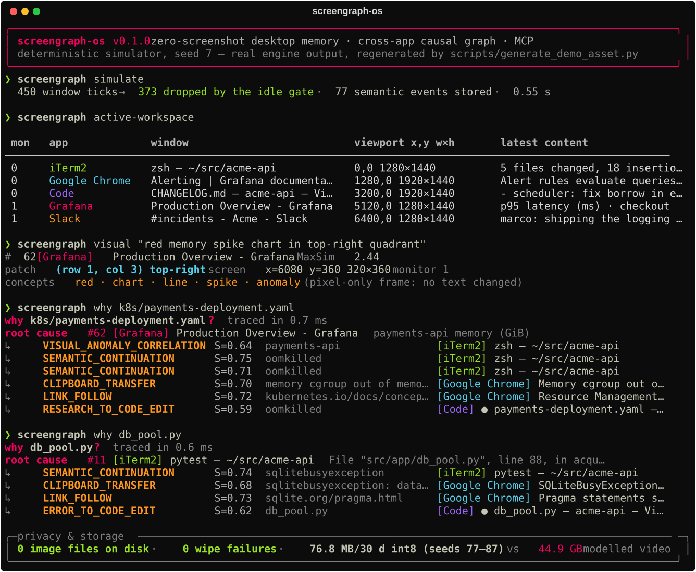
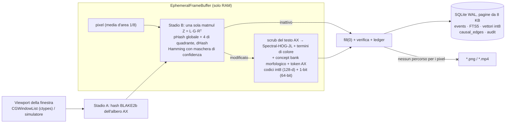
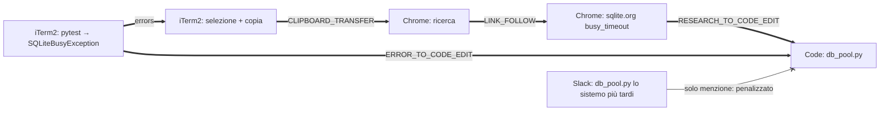

# screengraph-os

[English](README.md) · **Italiano**

<a href="https://paypal.me/giuseppegambino92"></a>

**La memoria del tuo desktop come grafo causale, non come video. Zero screenshot su disco.**



<sub>Output reale del motore sul simulatore deterministico (seed 7). I dati di storage nel footer provengono da <code>evals/latest_report.json</code>; il valore "legacy" è un modello parametrico di un video a 0.5 fps, non un prodotto misurato. Per rigenerarlo: <code>python scripts/generate_demo_asset.py</code>.</sub>

screengraph-os osserva le tue finestre come un debugger osserva la memoria. Suddivide il desktop in viewport per singola finestra e scarta i frame inattivi in circa 0.1 ms (p50) con un gate percettivo basato su DCT 2D. Ogni frame viene ridotto a patch embedding int8 + 1-bit e a testo di accessibilità ripulito, poi il buffer dei pixel viene azzerato con `memset(0)` prima che qualsiasi dato tocchi il disco. Ogni cambiamento semantico diventa un nodo in un **grafo causale cross-app basato su processi di Hawkes**. Questo ti permette di chiedere:

> *"Perché ho modificato `db_pool.py`?"*
> → `pytest` ha sollevato `SQLiteBusyException` nel terminale → l'hai copiata → l'hai cercata → hai aperto la documentazione di SQLite su `busy_timeout` → hai modificato `db_pool.py`.

screengraph-os viene distribuito come libreria, CLI Typer, TUI Rich e **server MCP** per Claude Code, Cursor e Gemini CLI. È costruito esclusivamente su `numpy` + `scipy` + SQLite (WAL, FTS5, blob vettoriali binari): niente LangChain/LlamaIndex, nessun server di vector DB, nessuna GPU. La cattura live su macOS usa CoreGraphics tramite `ctypes`, senza pyobjc e senza estensioni compilate.

```
$ screengraph why db_pool.py
why db_pool.py?  (0.6 ms)
  root cause #11 [iTerm2] pytest — ~/src/acme-api
     File "src/app/db_pool.py", line 88, in acquire
  chain
    [iTerm2] pytest — ~/src/acme-api <- SEMANTIC_CONTINUATION (errors:sqlitebusyexception)
    [Google Chrome] SQLiteBusyException: database is locked - Google Search <- CLIPBOARD_TRANSFER
    [Google Chrome] Pragma statements supported by SQLite <- LINK_FOLLOW (link:sqlite.org/pragma.html)
    [Code] ● db_pool.py — acme-api — Visual Studio Code <- ERROR_TO_CODE_EDIT (doc_path:db_pool.py)
```

> **Leggi qui prima di guardare i numeri.**
> - **I dati di accuratezza provengono da un simulatore deterministico di workspace sintetico** distribuito con il repository e sviluppato insieme al motore. Dimostrano che la pipeline è corretta end to end; non sono una prova di accuratezza su desktop reali.
> - **L'encoder visivo di default non richiede addestramento.** I descrittori spettrali DCT, HOG e di colore forniscono una firma generica delle patch (usata per la query-by-example). Le parole raggiungono i pixel attraverso due livelli progettati a mano e relativi alle dimensioni: i **termini di colore** di base e un **concept bank morfologico**. Il bank associa sette primitive d'immagine (curva sottile, escursione verticale, barre allineate, topologia nodo-arco, pillola con etichetta, overlay flottante, periodicità delle righe) a parole fisse ("spike", "tree", "badge", ...). Non contiene coordinate né colori del simulatore, ma è stato **progettato sapendo quali sei tipi di artefatto disegna il simulatore**, quindi il 6/6 sul simulatore è in-distribution. La prova che generalizza è il [test con renderer held-out](#3b-generalizzazione-held-out-del-concept-bank-morfologico): recall del 79–99 % per concetto su un seed di test nuovo, con i punti deboli documentati in quella sezione.
> - **La cattura live su macOS è stata verificata su un solo Mac** (permesso Registrazione schermo concesso, Accessibilità non concessa). La *qualità* del retrieval su desktop reali non è stata misurata: non esiste ancora un dataset reale etichettato.
> - **Il valore di storage "legacy" è un modello parametrico**, non la misura di un prodotto.

---

## Risultati

Misurati con `python -m evals.benchmark_suite --live 5` su un Mac Apple silicon (macOS 27.2, arm64, 14 core, Python 3.11.18, NumPy 2.4.6, SQLite 3.53.1). L'output grezzo è in [`evals/latest_report.json`](evals/latest_report.json). L'esecuzione completa richiede circa 69 s e comprende:
- un run di scala da 10,000 eventi e uno sweep su 10 seed
- due ablation dell'encoder
- il test morfologico held-out su due seed (2 × 840 scene) più la sonda held-out sul gate
- una cattura live di 5 tick

**Il load average durante l'esecuzione era 4.8–9.7 su 14 core**, dovuto ad altre applicazioni (una build Android e un simulatore iOS); il report lo registra all'inizio e alla fine. Ho atteso che il carico scendesse sotto 7 prima di partire; un run precedente con carico 15–20 aveva all'incirca raddoppiato ogni latenza. I dati di accuratezza e di storage sono deterministici e non risentono del carico.

**Carico di lavoro sintetico:** una sessione scriptata di 60 minuti su un ultra-wide 5120×1440 più un monitor 2560×1440. Cinque finestre (iTerm2, Chrome, VS Code, Grafana, Slack) producono 450 tick di finestra: 377 inattivi o con il solo movimento di cursore/caret e 73 cambiamenti semantici. La sessione contiene 4 catene di debugging multi-hop, 6 artefatti visivi, 15 segreti iniettati e hard negative come un messaggio in chat che nomina il file che sta per essere modificato.

### 1. Gate di inattività e storage (int8 + 1-bit)

| Metrica | screengraph-os | Nota |
|---|---|---|
| Frame scartati dal gate pHash + AX | **82.9 %** (373 / 450) | 98.9 % dei tick inattivi; 4 falsi passaggi dovuti al rumore del cursore |
| Cambiamenti semantici mancati | **0** / 73 | include il refresh della dashboard C4 che disegna lo spike visibile solo sul canvas (vedi §2 per i ridisegni con solo spike) |
| Latenza del gate, frame scartati (p50 / p95 / p99) | **0.113 / 0.186 / 0.241 ms** | p95 entro il budget di 0.20 ms; **il p99 non rispetta né il budget di 0.20 ms né il target < 0.16 ms**. Lo stadio di escursione della Fase 3b aggiunge ~0.018 ms di CPU (Fase 3: 0.089 / 0.133 / 0.193 ms) |
| Crescita dello storage per evento memorizzato | 4.1 KB | patch int8 2,048 B + globale int8 256 B + codici 1-bit 160 B + testo/FTS/archi |
| **Proiezione 30 giorni × 8 h** | **76.8 MB** (10 seed: 76.8–86.7 MB, media 82.5) | target < 95 MB ✅ |
| Stessa proiezione, formula della Fase 1 | 112.1 MB | vedi la nota sotto |
| File immagine / blob di dimensione paragonabile a un'immagine su disco | **0 / 0** (blob massimo 2,048 B) | |
| Buffer RAM non azzerati dopo l'ingest | **0** / 450 frame; 912 buffer (115 MB) azzerati, 0 verifiche fallite | |

*Metodo di proiezione.* La Fase 1 moltiplicava per 240 ore l'**intero** file del database, comprese le pagine fisse dello schema vuoto (147 KB). La formula attuale conta lo schema una sola volta e proietta solo la crescita oraria. Il valore calcolato con la vecchia formula è riportato accanto, così si può vedere quanta parte del miglioramento deriva dal cambio di metodo e quanta dal lavoro di ingegneria:
- quantizzazione scalare int8: circa 1.4 KB/evento risparmiati
- pagine SQLite da 8 KB: una riga vettoriale da 2.6 KB sprecava il 37 % di una pagina da 4 KB
- etichette di concetto sparse e compattate (`"red=.83 chart line"`). Le parole morfologiche avevano inizialmente portato due seed da 86.7 a 88.6 MB; la compattazione li ha riportati ai valori precedenti.

### 2. Tracciamento causale della root cause ("perché ho modificato questo file?")

| Metodo | Recall@1 della root cause | Precision / recall / F1 della catena |
|---|---|---|
| **screengraph-os** (encoder di default, concept bank morfologico) | **100 %** (4/4) | **1.000 / 1.000 / 1.000** |
| ablation: `morphology=False` (l'encoder della Fase 2) | 75 % (3/4) | 1.000 / 0.958 / 0.977 |
| ablation: `ui_concepts=True` tarato sul simulatore | 100 % (4/4) | 1.000 / 1.000 / 1.000 |
| Timestamp piatto ("cosa è successo subito prima?") | 0 % | F1 0.683 |
| Retrieval ibrido piatto (BM25 + dense, senza grafo) | 75 % | F1 0.475 |

Root recall, chain precision e chain recall valgono **1.000 su tutti i 10 seed dello sweep**. I messaggi di chat che si limitano a menzionare un file, senza testo di errore, trasferimento tramite appunti o link seguito, non entrano nella catena. È la *penalizzazione per sola menzione*.

La vera root della catena C4 è uno **spike di memoria in Grafana visibile solo sul canvas**: nessun testo cambia, solo i pixel. Due meccanismi permettono di recuperarlo:
1. Il **rilevatore di escursioni verticali** marca il frame come anomalia.
2. Il nuovo **bridge di anomalia visiva** lega l'escursione alla sua didascalia, cioè l'etichetta AX più vicina sopra la curva (`payments-api memory (GiB)`). Collega poi quella didascalia allo stato successivo, in un'altra finestra, il cui contenuto *nuovo* nomina lo stesso sottosistema. In questo caso si tratta di `kubectl get pods` che mostra `payments-api-… OOMKilled`, tramite un arco `VISUAL_ANOMALY_CORRELATION` con evidenza `payments-api`, `xmodal_cos=0.34` ed `energy=0.76`.

Uno spike che persiste nei refresh successivi è continuità, non una nuova evidenza, e non genera un nuovo bridge. Senza il bank (`morphology=False`), il trace si ferma un hop più a valle, su `kubectl`.

**Avvertenza:** il bridge vede solo i frame che il gate di inattività lascia passare. Un *refresh* della dashboard che ridisegna la serie passa, come in C4.

Uno spike che compare **senza nessun altro cambiamento nei pixel** sposta appena gli hash a bassa frequenza 8×8. Con i soli hash passavano appena 79 / 170 posizioni testate (46 %). Il gate ora ha uno **stadio di escursione**: per ogni colonna della griglia di luma 64×64 conta le righe che contengono un tratto verticale marcato, in bande da 16 righe, e lascia passare un frame quando il conteggio di una qualsiasi colonna cambia di ≥ 5 righe. Un cursore o un caret occupa ≤ 3 righe.
- **Simulatore:** i ridisegni con solo spike passano **170 / 170**. Nessuno dei 4,059 tick inattivi di cursore/caret scartati su 11 seed fa scattare lo stadio; la variazione massima osservata è stata di 3 righe.
- **Renderer held-out (seed nuovo):** i ridisegni con solo spike passano nell'**85.8 %** dei casi. Lo stadio aggiunge **0** falsi passaggi di cursore/caret; vedi §3b.

### 3. Patch-MaxSim visivo (encoder di default)

| Query | Patch-MaxSim R@1 | Patch (riga, col) | Quadrante OK | R@1 con media globale |
|---|---|---|---|---|
| red memory spike chart in top-right quadrant | ✅ | (1, 3) | ✅ | ✅ |
| blue architecture tree diagram | ✅ | (1, 2) | ✅ | ✅ |
| orange warning modal | ✅ | (1, 2) | ✅ | ✅ |
| green bar chart of build durations | ✅ | (3, 0) | ✅ | ✅ |
| red failing badge | ✅ | (0, 0) | ✅ | ❌ |
| cyan latency line chart | ✅ | (3, 2) | ✅ | ✅ |
| **Seed 7** | **100 %** (6/6) | | **100 %** (6/6) | 83 % |
| 10 altri seed (min / media) | 100 % / 100 % | | 100 % / 100 % | 83 % / 83 % |
| *ablation `morphology=False`* | *83 %* | | *83 %* | *50 %* |
| *ablation `ui_concepts=True`* | *100 %* | | *100 %* | *83 %* |

Le query testuali raggiungono i pixel tramite i termini di colore, il testo posizionato a schermo e le parole del concept bank morfologico. Il **binding del colore** è decisivo per "red failing badge". Ogni oggetto rilevato porta con sé il proprio colore, quindi la patch riceve un composto `red_badge` e la query "red badge" aggiunge lo stesso composto. Una riga di log rossa accanto a un badge verde non produce un match.

- **int8 vs float32:** Recall@1 e localizzazione identiche su tutti i seed. Sul seed 7 l'evento e la patch in prima posizione sono identici per 6/6 query; su 2 dei 10 seed dello sweep una query risolve in modo diverso un pareggio tra stati quasi identici.
- **Prefisso Matryoshka 64-d:** R@1 100 %. **MaxSim puro su distanza di Hamming con codici 1-bit a 64 bit** (solo il prefiltro, senza rescoring): 67 %, ed è per questo che viene usato solo come stadio 1.
- **Query-by-example (`screengraph visual --like EVENT`):** usa il descrittore generico Spectral-HOG-JL. Ordina le finestre che hanno aspetto e contenuto testuale simili.

### 3b. Generalizzazione held-out del concept bank morfologico

Il bank è stato progettato sui sei tipi di artefatto del simulatore, quindi `evals/morph_heldout.py` disegna le scene con un **renderer indipendente**:
- dimensioni del canvas casuali (120–320 × 150–420) e sfondi chiari o scuri
- **tonalità casuali** anziché la palette del simulatore, tratti da 1–3 px
- blur di anti-aliasing su metà delle scene, rumore del sensore (σ 0–4) e una variante **upscalata 2×** di una scena su due
- testo di disturbo in ogni scena
- hard negative: serie volatili senza spike, griglie di box non collegati e griglie di card, pannelli laterali ancorati, quadrati colorati senza etichetta e testo colorato

**Protocollo.** Il seed 1234 è lo split di sviluppo. La Fase 3 ha poi usato il seed 98765 come split di test. La Fase 3b ha tarato tre rilevatori *dopo aver visto* quei risultati aggregati, quindi 98765 non è più pulito. I numeri della Fase 3b provengono da un **nuovo seed, 20261113, eseguito una sola volta** dopo il congelamento dei rilevatori: 60 scene per caso, 840 scene in totale, `morph_heldout_test_split` nel report.

| Concetto | Fase 3 (seed 98765) | **Fase 3b, seed nuovo 20261113**: recall (1× / 2×) | FPR | Note |
|---|---|---|---|---|
| modal (overlay flottante) | 98 % / FPR 0.3 % | **99 %** (98 / 100) | 0.3 % | inclusa la variante con lo sfondo circostante oscurato |
| tree (topologia nodo-arco) | 88 % / 0 % | **90 %** (93 / 87) | 0 % | connettori a gomito e diagonali; i box non collegati non scattano mai |
| badge (pillola con etichetta) | 87 % / **14.9 %** | **95 %** (100 / 90) | **8.1 %** | griglie di card ora a 0 %. I falsi positivi residui sono box non collegati con layout ad albero (47 / 60 scene, a ben vedere assimilabili a pillole) e il 15 % delle scene con testo colorato |
| grafico a barre | 83 % / 0 % | **83 %** (83 / 83) | 0 % | |
| spike (escursione verticale) | 62 % / 0 % | **79 %** (83 / 75) | **0 %** | serie calme 93 %, **serie volatili 65 %** (era 37 %) |

Il seed già visto 98765, rieseguito dopo le modifiche, dà spike al 75 % ma con **1 falso spike su 720 negativi**, su una serie volatile senza spike. Quindi "zero falsi spike" vale sul seed nuovo, sul simulatore e sullo split di sviluppo, ma **non è una garanzia**.

Cosa è cambiato nella Fase 3b. Tutte e tre le modifiche sono state sviluppate sul seed 1234 e sul simulatore:
1. **Spike su linee frastagliate: z-score robusto locale.** Il MAD globale di un random walk è gonfiato dalla deriva lenta. Si rimuove il trend dall'inviluppo superiore con una mediana mobile sul 20 % della larghezza, poi si richiede:
   - $z_{loc} = \max r / (1.4826\,\mathrm{MAD}(r)+\epsilon) \ge 7$
   - prominenza residua ≥ 20 % dell'altezza
   - FWHM ≤ 8 %
   - un picco *unico*, senza nessun altro picco residuo al di fuori di ±4 % che raggiunga il 60 % della sua altezza

   **La soglia suggerita di 3.5 MAD è stata provata e scartata.** Produceva 8–18 falsi spike su 294 curve di dashboard del simulatore, e un falso spike attiva il flag di anomalia causale. Una soglia di 6 produceva ancora un falso spike sullo split di sviluppo (z = 6.0 su una serie alta 23 px), quindi la soglia è 7.
2. **Isolamento dei reticoli di badge:** una pillola viene scartata se più di 2 componenti compatte della stessa dimensione (±10 %) condividono la sua riga o colonna. *Compromesso:* un elenco reale di quattro o più badge di stato identici in una colonna, come un elenco di pipeline CI, non verrà più riconosciuto come "badge". La pagina CI del simulatore ne ha esattamente 3, quindi non è interessata.
3. **Stadio di escursione del gate:** vedi §2. Sul seed di sviluppo ha portato i passaggi dei ridisegni con solo spike dal 52.5 % (con i soli vecchi hash) all'86.7 %; le bande sovrapposte (stride 8) sono state aggiunte dopo che una prima versione con 4 bande fisse si era fermata all'84.2 %.

**Sonda del gate sul renderer held-out** (`python -m evals.morph_heldout --gate`, seed nuovo, 120 coppie spike/no-spike, 360 frame di cursore/caret):

| | Risultato |
|---|---|
| ridisegni con solo spike lasciati passare | **85.8 %** (39 dei quali solo grazie allo stadio di escursione) |
| frame di cursore/caret lasciati passare per errore, totale | **14.2 %**: tutti tramite i *vecchi* stadi pHash/dHash/quadranti, soprattutto in scala 2×, dove il cursore è più grande |
| falsi passaggi di cursore/caret tramite lo stadio di escursione | **0** |

La sonda modella il rumore come una texture statica della scena, perché una finestra invariata viene ridisegnata identica byte per byte. Con **rumore del sensore indipendente per ogni frame** (σ = 2), il dHash esistente lascia passare **tutti** i frame dal contenuto identico. Così com'è, il gate non è adatto a sorgenti da fotocamera o di tipo video.

Storia della Fase 3 sullo split di sviluppo:
- **v1, prima di qualsiasi modifica:** spike 51 %, tree 40 %, badge 80 % con il 18 % di falsi positivi, modal 99 %, bars 85 %.
- **Bug del renderer, non una modifica al rilevatore:** la maggior parte dei tree mancati derivava dal mio renderer, che disegnava i segmenti verticali dei connettori come pixel singoli. Con il renderer corretto e il rilevatore invariato, la recall sui tree era dell'88 %.
- **Due correzioni generiche al rilevatore:**
  - maschera dei colori salienti basata sullo spread tra i canali, perché i tratti con anti-aliasing perdono saturazione
  - FWHM vera (il tratto contiguo attorno al picco)
- **Una correzione scartata:** z ≥ 2 sulle serie volatili, che causava un falso spike sul simulatore.

**Sulle finestre reali**, il run live **non** ha attivato alcun concetto del bank sui 10 stati di finestra reali memorizzati e ha impostato **0** flag di anomalia. Lì non c'è ground truth: il risultato mostra l'assenza di falsi flag di spike su questo piccolo campione, non che i grafici reali vengano rilevati.

### 4. Privacy e oscuramento dei segreti

| Metrica | Risultato |
|---|---|
| Segreti iniettati assenti dai byte del DB, dalle colonne di testo e dal vocabolario FTS5 | **15 / 15** (su tutti i 10 seed dello sweep: 15 / 15) |
| Fuzz test dello scrubber (200 set di segreti casuali, in contesto) | 0 leak |
| Collegabilità cross-app | la chiave OpenAI copiata da terminale → Slack mantiene un unico tag `<REDACTED_SECRET:…>`, collegato da un arco `CLIPBOARD_TRANSFER` |

### 5. Latenza (p50 / p95 / p99, ms)

| Stadio | p50 | p95 | p99 |
|---|---|---|---|
| (a) controllo del gate pHash + escursione (frame scartati) | 0.113 | 0.186 | 0.241 |
| (b) encoding Spectral-HOG-JL + concept bank morfologico + quantizzazione int8/1-bit + azzeramento della RAM | 2.754 | 3.933 | 4.888 |
| Scrub delle PII | 0.155 | 0.360 | 0.443 |
| (c) inferenza degli archi causali | 0.122 | 0.300 | 0.343 |
| Transazione SQLite | 0.121 | 0.227 | 0.319 |
| **Ingest totale per frame memorizzato** (budget < 10) | **3.678** | **4.991** | **6.072** |
| (d) retrieval ibrido RRF a 4 vie + grafo, 77 eventi (budget < 8) | 1.206 | 1.940 | 2.740 |
| (d) idem, **10,000 eventi** | **2.667** | **4.432** | 4.782 |
| trace causale `why`, 10,000 eventi | 2.525 | 3.767 | – |

Il concept bank morfologico aggiunge circa 0.5–0.8 ms di CPU per frame memorizzato (un passaggio di componenti connesse, un passaggio di etichettatura dei buchi solo quando esiste una componente a forma di pillola, una FFT di autocorrelazione per righe).

A 10,000 eventi, pari a circa 16 giornate da otto ore al ritmo simulato, il DB occupa 41.0 MB. L'ingest è 3.21 / 4.05 / 6.07 ms (p50/p95/p99), con un massimo di 11.7 ms, sopra il budget di 10 ms. Un microbenchmark ripetuto del gate con carico ~8 (7,087 controlli su frame scartati) ha dato p50 0.084 ms ma p99 0.296 ms: la coda è dovuta al jitter di scheduling sotto carico, non alla matmul.

### 6. Cattura live su macOS (`screengraph capture-live --ticks 5 --interval 1.0`)

Questo test è stato eseguito su questa macchina come parte del benchmark (`--live 5`). Il report memorizza solo dati aggregati: nessun titolo, nome di app o testo.

| | Risultato |
|---|---|
| Permessi | Registrazione schermo ✅ · Accessibilità ❌ (non concessa, e non richiesta) |
| Finestre per tick | 8 × 5 tick → 40 frame, **40 con pixel reali**, 0 con testo AX |
| Gate | 29 scartati, 11 memorizzati |
| **Ingest del motore** (p50 / p95 / max) | **0.106 / 3.305 / 3.855 ms**, tutti sotto i 10 ms ✅ (ma vedi la nota sotto) |
| Encoding + morfologia + quantizzazione + azzeramento sui pixel reali | 2.36 / 3.03 ms (p50 / p95) |
| Concept bank morfologico sulle finestre reali | `modal` attivato su 1 degli 11 stati memorizzati, non verificato; nessuno spike, 0 flag di anomalia (nessuna ground truth) |
| Lato sistema operativo (escluso dall'ingest) | `CGWindowListCreateImage` 28.7 ms p50 per finestra; ~236 ms per tick da 8 finestre |
| Audit zero pixel | 0 file immagine, 0 blob di dimensione paragonabile a un'immagine, 0 frame non azzerati dopo l'ingest → **PASS** |

**Instabilità del test live:** il test live pytest opzionale richiede che *ogni* frame live resti sotto i 10 ms. È fallito una volta su tre run live in questa sessione, durante un periodo con carico 15–20: in quel momento i tempi di encoding erano all'incirca raddoppiati, così come la cattura delle finestre da parte del sistema operativo, che non dipende da noi.

Il run live ha individuato e corretto due bug reali che il simulatore non aveva mai fatto emergere. Le finestre più piccole della griglia interna dell'encoder mandavano in crash lo stadio HOG, e le finestre più piccole di 64 pixel di griglia avrebbero mandato in crash il resampler del gate. Ora in entrambi i casi il ricampionamento è esatto, con relativi test di regressione.

---

## Avvio rapido

```bash
git clone <this repo> && cd screengraph-os
python3.11 -m venv .venv && . .venv/bin/activate
pip install -e ".[dev]"

screengraph simulate                         # replay the deterministic 60-min, 2-monitor session
screengraph why db_pool.py                   # root cause + chain + Mermaid graph
screengraph visual "orange warning modal"    # colour + on-screen-text visual search with patch localization
screengraph visual --like 12                 # query-by-example: windows that look like event 12
screengraph search "jwt expired"
screengraph timeline --minutes 15 --causal-only
screengraph active-workspace                 # zero-screenshot semantic state of every window
screengraph privacy-audit                    # zero-pixel proof + redaction counters
screengraph status                           # Rich TUI (live: screengraph dash --simulate)
screengraph eval [--live 5]                  # benchmark -> evals/latest_report.json
pytest                                       # 92 tests (1 opt-in live test: SCREENGRAPH_LIVE_TEST=1)
```

**Desktop reale (macOS).** Serve il permesso Registrazione schermo per il tuo terminale. L'Accessibilità è opzionale: aggiunge il testo AX, e puoi far comparire la richiesta di autorizzazione con `--request-ax`.

```bash
screengraph capture-live --ticks 5 --interval 1.0             # self-test into a temporary DB (deleted afterwards)
screengraph --home ~/.screengraph capture-live --ticks 600 --keep   # keep a real memory
screengraph capture --git-repo ~/src/myproject                # long-running: windows + git working tree
```

`--allow-clipboard` abilita esplicitamente `pbpaste`; in caso contrario gli appunti non vengono mai letti. Linux (X11 `wmctrl`/`xdotool`) e Windows (`EnumWindows`) forniscono solo i metadati delle finestre e qui non sono stati testati.

**Visione appresa opzionale:** `pip install -e ".[clip]"` e imposta `Config(vision_adapter="open_clip:ViT-B-32/laion2b_s34b_b79k")`. Gli embedding di immagine e di testo dell'adapter vengono mappati nello stesso spazio con una mappa ortogonale fissa, quindi storage, BQ e MaxSim restano invariati. **Questo percorso qui non viene esercitato**: torch/open_clip non sono installati e i pesi andrebbero scaricati. Solo l'integrazione dell'adapter è coperta da unit test, con un adapter fittizio. Poiché le patch sono ritagliate dalla cattura in scala 1/8, un adapter appreso richiederebbe crop a risoluzione più alta.

---

## MCP: Claude Code, Cursor, Gemini CLI

```bash
claude mcp add screengraph -- /abs/path/to/.venv/bin/screengraph mcp
```

```json
{ "mcpServers": { "screengraph": {
    "command": "/abs/path/to/.venv/bin/screengraph", "args": ["mcp"],
    "env": { "SCREENGRAPH_HOME": "/Users/you/.screengraph" } } } }
```

Il blocco JSON va in `~/.cursor/mcp.json` (Cursor) o in `~/.gemini/settings.json` (Gemini CLI). Il server parla JSON-RPC 2.0 su stdio (protocollo `2025-06-18`, `2025-03-26`, `2024-11-05`) ed espone questi tool:
- `screengraph_active_workspace`
- `screengraph_causal_why`
- `screengraph_visual_search`
- `screengraph_timeline_replay`
- `screengraph_ingest_event`
- `screengraph_privacy_audit`
- `screengraph_search` (ibrido a 4 vie)

Chiama `refresh()` prima di ogni query, così un processo `capture` separato può continuare a scrivere; SQLite in modalità WAL consente un writer e molti reader.

---

## Architettura





Struttura dei sorgenti:
- `capture/`: `ephemeral.py` (azzeramento + ledger SHA-256), `phash.py` (gate fuso), `live.py` (macOS via ctypes), `os_hooks.py` (Linux/Windows/appunti/git), `simulator.py`.
- `embeddings/`: `patch_encoder.py` (Spectral-HOG-JL, int8/1-bit, adapter), `morphology.py` (concept bank morfologico cross-modale), `maxsim.py` (funnel + MaxSim + IDF), `ui_concepts.py` (ablation *opzionale*).
- `evals/`: `benchmark_suite.py`, `morph_heldout.py` (test di generalizzazione con renderer indipendente).
- `graph/`: `causal_engine.py`, `retriever.py`.
- `db/`, `privacy/`, `interfaces/` (MCP, TUI, CLI) ed `engine.py`, che orchestra la pipeline.

---

## La matematica

**Gate.** Si calcola la media d'area del frame su una griglia di luma 64×64 $G_2 = A_r X (A_c^\top\otimes w)$. Un **unico** prodotto $Z = L\,G_2\,R^\top$ fornisce poi tutti gli input degli hash. $L$ e $R$ impilano tre elementi:
- $C_8 M$: la DCT 8×8 a bassa frequenza del frame mediato 2×
- $\mathrm{blockdiag}(C_8, C_8)$: le quattro DCT di quadrante
- le righe di media 8×9 del dHash

I bit del pHash sono $D_k > \mathrm{median}(D_{1..63})$. Contano solo i bit affidabili: $|D_k - \mathrm{med}| \ge 0.25\,\overline{|D-\mathrm{med}|}$, e $d(a,b) = \mathrm{popcount}((h_a\oplus h_b)\wedge m_a\wedge m_b)$. Un frame viene scartato se e solo se l'hash AX è invariato, $d_{\text{global}}\le4$, $d_{\text{dHash}}\le6$, $\max_q d_q\le2$, **e** il delta di escursione è inferiore a 5 righe.

L'impronta di escursione è $E_{b,c}=\mathrm{card}\,\lbrace y\in\text{band }b : \lvert G_2[y,c+1]-G_2[y,c]\rvert>24\rbrace$. Copre 7 bande sovrapposte da 16 righe (stride 8) × 63 colonne ed è memorizzata come `uint8`; è un conteggio per colonna, non un'immagine. Il delta è $\max_{b,c}\lvert E_{b,c}-E'_{b,c}\rvert$. Aggiunge circa 0.018 ms di CPU per controllo.

**Descrittore Spectral-HOG-JL** (per ogni patch $p$ di una griglia 4×4, con qualsiasi input RGB/RGBA):
- **Spettrale:** canali opponenti $Y=0.299R+0.587G+0.114B$, $O_1=R-G$, $O_2=B-\tfrac{R+G}{2}$, mediati per area a 16×16. DCT-II ortonormale $C\,B\,C^\top$, mantenendo lo zig-zag $u+v<6$ per $Y$ (21 coefficienti) e $u+v<3$ per ciascun canale di crominanza (6 + 6), con compressione signed-sqrt.
- **Gradienti:** Scharr a 32×32, un istogramma delle orientazioni senza segno a 8 bin (pesato per magnitudo, con normalizzazione di Hellinger), densità dei bordi e magnitudo media.
- **Colore:** frazioni dei termini di colore di base (11).

Ogni gruppo viene normalizzato L2 e concatenato in $f_p\in\mathbb{R}^{54}$. Il risultato viene proiettato con una matrice di Achlioptas con seed $R_{ij}\in\lbrace\pm1/\sqrt d\rbrace$, che soddisfa il lemma di Johnson-Lindenstrauss, e poi reso **ortogonale al sottospazio delle parole di colore**: $\tilde R = R - R\,Q_cQ_c^\top$, con $Q_c$ = QR della base dei concetti di colore. L'energia di texture quindi non viene mai interpretata come corrispondenza di colore. Un unit test verifica che $|\,\tilde R^\top f\cdot B[\text{colour}]\,|<10^{-4}$.

**Concept bank morfologico** (`embeddings/morphology.py`). Le componenti connesse della maschera dei colori salienti (spread tra i canali ≥ 12 % del fondo scala) vengono misurate con soglie espresse come frazioni della dimensione della finestra o dell'oggetto:

| Primitiva | Test | Parole del bank |
|---|---|---|
| curva sottile | larghezza ≥ 10 % della finestra, riempimento ≤ 0.3, copertura delle colonne ≥ 85 % | chart, line |
| escursione verticale | profilo della sommità delle colonne $h$, uno dei due test. **Globale:** z robusto $z=\frac{\max h-\mathrm{med}\,h}{1.4826\,\mathrm{MAD}(h)+\epsilon}\ge6$ (oppure $\ge3$ e svettante di ≥ 25 % su tutte le altre colonne), FWHM ≤ 8 % della larghezza, salita locale ≥ 60 % della prominenza entro ±4 %. **Locale:** lo stesso z su $r=h-\mathrm{runmed}_{20\%}(h)$, ≥ 7, con un picco unico | spike, anomaly (+ chart, line) |
| barre allineate | ≥ 3 componenti piene dello stesso colore su un'unica linea di base, larghezze simili, spaziature regolari, altezze variabili | chart, bar |
| topologia nodo-arco | ≥ 3 box simili su ≥ 2 livelli con fratelli, uniti da componenti sottili in primo piano che toccano ≥ 2 box | tree, diagram |
| pillola con etichetta | rapporto d'aspetto 1.5–7, piccola dimensione, buchi contrastanti racchiusi 3–50 %, ≤ 2 fratelli della stessa dimensione nel reticolo | badge |
| overlay flottante | ≥ 3 % della finestra, non tocca il bordo, centrato | modal |
| periodicità delle righe | picco di autocorrelazione (lag 2–10) del profilo per riga del gradiente orizzontale | table (debole, 0.4) |

Ogni oggetto lega il proprio colore, producendo composti come `red_spike`. I suoi pesi di patch $u_{pk}$ entrano nello stesso spazio dei token di query attraverso i vettori delle parole.

**Vettore di patch.**

$$w_p = \mathrm{norm}\Big(0.6\,\widehat{\tilde R^\top f_p} + \widehat{\textstyle\sum_c v_{pc}B[c]} + \frac{\sum_k u_{pk}B[k]}{\max(1,\lVert\sum_k u_{pk}B[k]\rVert)} + 0.8\,\widehat{\textstyle\sum_t \log_2(1+\sum_{n\ni t}\omega_n)\,B[t]}\Big)$$

$B[\cdot]$ sono vettori di concetto gaussiani con seed, condivisi da patch e token di query. $v_{pc}$ è la quota di colore saliente, $u_{pk}$ sono i pesi del bank e i $t$ sono i token AX ripuliti, collocati nella patch in cui vengono renderizzati. Lo spazio condiviso è memorizzato come prefisso Matryoshka int8 128-d. La proiezione del descrittore è resa ortogonale ai sottospazi delle parole di colore **e** di quelle del bank. "Zero-shot" qui significa senza dati di addestramento. La tabella parola ↔ primitiva qui sopra *è* l'allineamento, scritto a mano.

**int8 + 1-bit.** Per ogni finestra, $s = \max|w_{p,i}|/127$ e $q=\mathrm{round}(w/s)$ sul prefisso Matryoshka 128-d. Lo stadio 1 usa codici di segno a 64 bit con un funnel distanza di Hamming → LUT del coseno. Lo stadio 2 è un rescoring **asimmetrico**, $s_n\,(q_{\text{float32}}\cdot q^{(n)}_{\text{int8}})$.

**MaxSim con IDF della query e prior spaziale.**

$$\mathrm{MaxSim}(Q,W)=\sum_i \mathrm{idf}_i\max_p s_p\,(q_i\cdot w_p),\qquad \mathrm{idf}_i = 1+\ln\tfrac{1+n}{1+\mathrm{df}_i}$$

**Score causale + responsabilità di Hawkes.**

$$S(i\to j)=0.25\,e^{-\lambda\Delta t}+0.20\cos(E_i,E_j)+0.45\,\mathrm{Bridge}+0.10\,P(\mathrm{app}_j\mid\mathrm{app}_i),\qquad p(i\to j)=\frac{S(i\to j)}{\mu+\sum_k S(k\to j)}$$

Un arco viene mantenuto se e solo se $S\ge0.40$ e porta con sé un'evidenza. Diverse regole stabiliscono cosa conta come evidenza:
- **Novità nella destinazione:** l'evidenza deve essere nuova nella finestra stessa di $V_j$.
- **Soppressione delle entità ambientali:** le entità presenti in più del 35 % degli eventi recenti vengono ignorate.
- **Penalizzazione per sola menzione:** per una sorgente di chat senza errore, i bridge su path/simboli vengono moltiplicati per 0.35.
- **Bridge di anomalia visiva:** un'escursione *nuova* nella finestra $i$ porta con sé le entità della sua didascalia $c_i$, cioè l'etichetta AX più vicina sopra la curva. Se si sovrappongono alle nuove entità della destinazione, $\mathrm{Bridge}=\min\big(1,\;0.5+0.3\,e_i+0.4\max(0,\cos(a_i,E_j))\big)$. Qui $e_i=\min(1,z/12)$ è l'energia dell'escursione e $a_i$ è il vettore di anomalia cross-modale (token della didascalia + `spike`, `anomaly`) nello stesso spazio di concetti dell'embedding di stato $E_j$. La soppressione delle entità ambientali non si applica, perché l'anomalia è proprio l'evidenza specifica.

La root è l'errore o l'anomalia più precoce nell'ascendenza causale, ordinata in base alla media geometrica degli score degli archi.

Il **retrieval** è un RRF su:
- BM25 di FTS5 (con pruning dei termini con df > 20 %, su un worker thread)
- coseno denso
- Patch-MaxSim
- un canale di propagazione sul grafo causale

---

## Confronto con altri progetti

Tutte le affermazioni sui concorrenti riportate di seguito sono **tratte dalla documentazione di ciascun progetto** (consultata a nov 2026; fonti linkate). Sono dichiarazioni dei progetti stessi, non risultati di benchmark nostri. I prodotti cambiano.

| | **screengraph-os** | Microsoft Recall | Screenpipe | ScreenMind | AgenticVision |
|---|---|---|---|---|---|
| Cosa viene persistito | testo AX + vettori di patch int8/1-bit + grafo causale; **nessuna immagine** | **Snapshot** periodici (screenshot) + un vector DB, cifrati | **Screenshot JPEG** + chunk audio (`~/.screenpipe/data`) + testo in SQLite | **Screenshot** su disco (`~/.screenmind`), eliminati automaticamente dopo N giorni (default 7) + SQLite | **Miniature JPEG** + metadati in un file binario `.avis` |
| Trigger di cattura | hash AX per finestra + gate pHash/quadranti | snapshot periodici | event-driven (cambio app, focus, clic, pause nella digitazione, appunti), fallback a ~5 s in caso di inattività | rilevamento dei cambiamenti di contenuto con deduplica pHash, intervallo massimo 40 s | on demand (file, base64, screenshot, appunti) |
| Sorgente del testo | albero di accessibilità (+ titoli delle finestre) | indice semantico on-device sugli snapshot | prima l'albero di accessibilità, OCR come fallback | analisi visiva con Gemma 4 + EasyOCR | descrizione dell'immagine / metadati |
| Rappresentazione visiva | patch Spectral-HOG-JL senza addestramento + concept bank morfologico progettato a mano (adapter appreso opzionale) | AI on-device (NPU) | – | embedding testuali MiniLM dell'analisi | CLIP ViT-B/32 (512-d) via ONNX |
| Gestione di segreti / PII | oscuramento basato su formato + Luhn + entropia **prima dell'indicizzazione**; tag collegabili basati su chiave | filtro delle informazioni sensibili attivo di default: gli snapshot con password/carte rilevate **non vengono salvati** | "PII redaction" elencata; meccanismo non documentato | filtro dei dati sensibili (carte, SSN, chiavi API, JWT, password) attivo di default | rimozione dei metadati EXIF/posizione |
| Cifratura at rest | non integrata (ci si affida alla cifratura del disco) | sì (TPM / Windows Hello ESS, enclave VBS) | non indicata nel documento di architettura | opzionale (Fernet), disattivata di default | non indicata |
| Grafo causale cross-app del "perché" | **sì** | non documentato | non documentato | non documentato | non documentato |
| Localizzazione spaziale a livello di patch | sì (riga, col, bbox a schermo) | non documentato | non documentato | regioni di layout nell'analisi | diffing a livello di pixel |
| Server MCP | sì (7 tool) | non documentato | sì (`screenpipe-mcp`) | sì (stdio) | sì (21 tool) |
| Piattaforme | cattura live su macOS verificata; metadati Linux/Windows (non testati) | PC Copilot+ con Windows 11 | macOS, Windows, Linux | Windows, macOS, Linux | core in Rust; benchmark su macOS |

"Non documentato" significa che non l'abbiamo trovato nella documentazione citata, non che la funzionalità sia assente.

Il **valore legacy di "44,949 MB/mese"** in `evals/` modella una cattura video continua a 0.5 fps. **Non** è un modello di questi prodotti: strumenti event-driven come Screenpipe e ScreenMind memorizzano molto meno, e non li abbiamo misurati.

Fonti:
- Microsoft: [Gestire Recall](https://learn.microsoft.com/en-us/windows/client-management/manage-recall), [Privacy e controllo sull'esperienza Recall](https://support.microsoft.com/windows/d404f672-7647-41e5-886c-a3c59680af15), [Architettura di sicurezza di Recall](https://blogs.windows.com/windowsexperience/2024/09/27/update-on-recall-security-and-privacy-architecture/)
- Screenpipe: [architettura](https://docs.screenpipe.com/architecture)
- ScreenMind: [ayushh0110/ScreenMind](https://github.com/ayushh0110/ScreenMind)
- AgenticVision: [agentralabs/agentic-vision](https://github.com/agentralabs/agentic-vision)

---

## Metodologia dei benchmark e avvertenze

- **Il simulatore è stato sviluppato insieme al motore.** I risultati della Fase 1 (100 % sul visivo e su C4) provenivano da rilevatori di oggetti scritti insieme ai renderer del simulatore; restano disponibili come ablation esplicita (`Config(ui_concepts=True)`).
  - Il **concept bank morfologico** di default non usa coordinate, colori o dimensioni dei glifi del simulatore. Però è pensato esattamente per i tipi di artefatto e le parole di query del simulatore, quindi i suoi 6/6 e 4/4 sono **in-distribution**.
  - Il renderer held-out (§3b) è la prova di generalizzazione, e mostra punti deboli reali: gli spike su serie volatili e i falsi positivi sui badge.
- **Diverse regole del motore sono state aggiunte dopo che il benchmark aveva evidenziato dei fallimenti:**
  - la rimozione del prompt della shell
  - la novità nella destinazione
  - il limite di parent per finestra
  - l'IDF della query
  - la penalizzazione per sola menzione
  - il bridge di anomalia visiva legato alla didascalia (Fase 3)
  - nel concept bank morfologico, la maschera basata sullo spread cromatico e la larghezza FWHM, individuate sullo split di *sviluppo* held-out
  - Fase 3b: il test di spike con z-score robusto locale, l'isolamento dei reticoli di badge e lo stadio di escursione del gate (split di sviluppo + simulatore; valutati una sola volta su un seed nuovo)

  Lo sweep su 10 seed fa variare rumore, dati e segreti, non lo script. Dimostra stabilità, non generalizzazione.
- **Le baseline sono nostre reimplementazioni.** Il timestamp piatto e il retrieval ibrido piatto (BM25 senza pruning + dense, escludendo gli eventi della stessa finestra e quelli futuri) si trovano in questo codebase. La baseline con media globale usa lo stesso encoder e la stessa IDF della query di Patch-MaxSim.
- **La garanzia zero pixel, nel dettaglio:**
  - Nessuna API di storage accetta pixel.
  - Ogni frame buffer e ogni dato intermedio registrato derivato dai pixel (inclusa la copia float a piena risoluzione del gate e i buffer di ricampionamento dell'encoder) viene azzerato e verificato all'uscita, anche in caso di eccezioni.
  - Nella cattura live, la nostra copia privata `CFData` della bitmap viene azzerata con `memset` prima di `CFRelease`.
  - I test verificano che nessun file su disco sia un frame (SHA-256) e che nessuna finestra di pixel ad alta varianza proveniente da un frame semantico compaia su disco.

  Non coperto: il backing store del `CGImage` appartiene a CoreGraphics, e NumPy può creare copie interne temporanee che non possiamo azzerare.

### Limitazioni note / roadmap

- **Una visione ampia ancorata alle parole richiede un modello appreso.** Il bank copre sette primitive; qualsiasi altra cosa ("form di login", "mappa", "foto di un gatto") produce match solo tramite i termini di colore e il testo a schermo. L'adapter open_clip è integrato ma qui non è stato testato. La qualità del retrieval su desktop reali richiede un dataset etichettato.
- **Ridisegni con solo spike:** lo stadio di escursione del gate ne lascia passare l'85.8 % sul renderer held-out (100 % sul simulatore), quindi circa 1 su 7 continua a non raggiungere mai i rilevatori.
- **I rilevatori più deboli del bank:** falsi positivi sui badge (8.1 %, per lo più box non collegati con layout ad albero), recall degli spike su serie volatili (65 %) e 1 falso spike su 720 su un seed già visto.
- **Sensibilità del gate al rumore:** i vecchi stadi pHash/dHash/quadranti lasciano passare il 14 % dei frame held-out di cursore/caret in scala 2×, e tutti i frame in presenza di rumore del sensore indipendente per ogni frame.
- **Il testo AX su macOS richiede il permesso Accessibilità.** Senza di esso, la cattura live indicizza solo i titoli delle finestre + i pixel. Il testo tramite AT-SPI su Linux e UIAutomation su Windows non è implementato.
- **Il target p99 del gate non è raggiunto.** In questo run il p99 è 0.241 ms, con lo stadio di escursione e carico 5–10. La Fase 3, senza lo stadio, registrava 0.193 ms, e 0.159 ms su una macchina scarica. Il p50 resta intorno a 0.1 ms; la coda segue il carico della macchina.
- **Il ranking della root** usa un'euristica basata sul "primo segnale di fallimento". Le anomalie visibili solo sul canvas contano come segnali di fallimento solo quando scatta il rilevatore di escursioni.

## Licenza

[MIT](LICENSE)

## Supporta il progetto

Se questo progetto ti è utile, puoi sostenerne lo sviluppo con una donazione su PayPal:

<a href="https://paypal.me/giuseppegambino92"></a>
