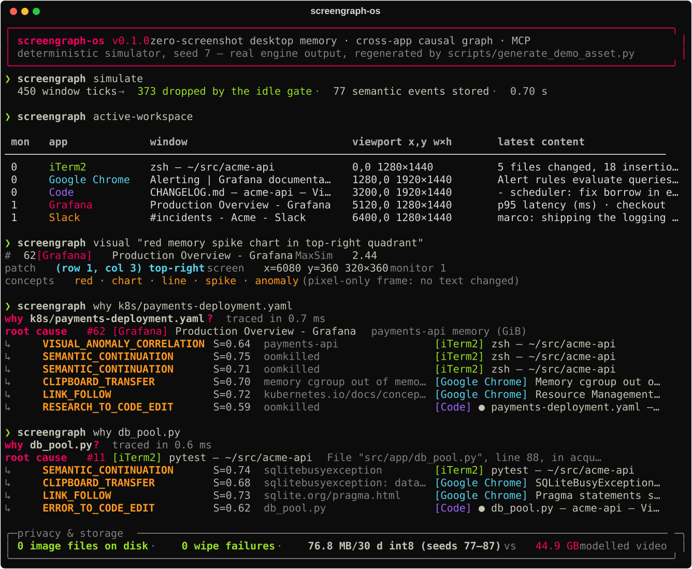
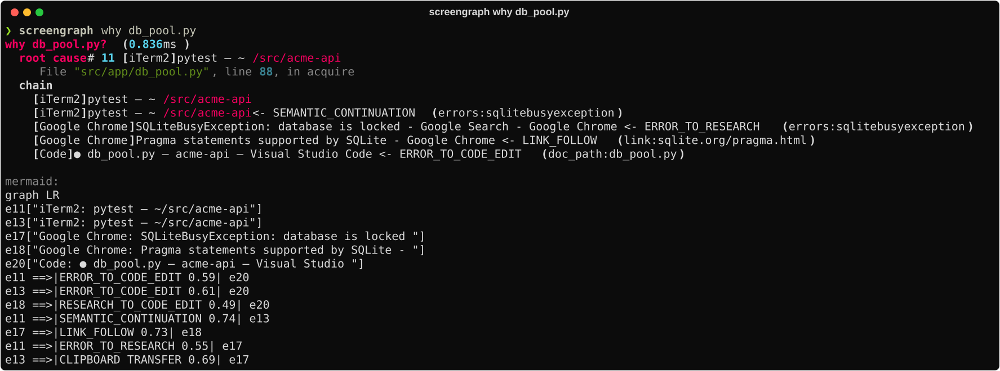
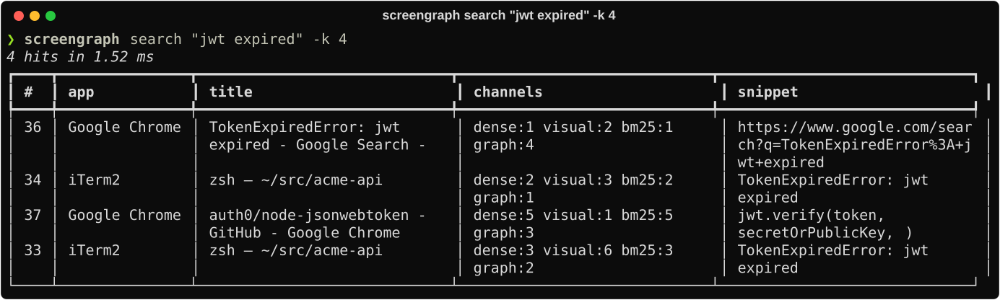
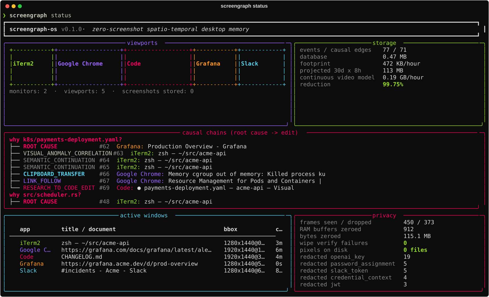
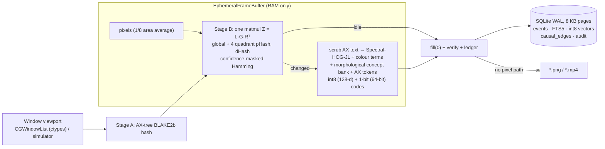
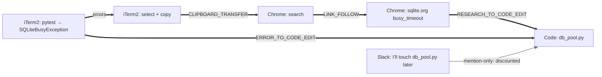

# screengraph-os

**English** · [Italiano](README.it.md)

<a href="https://paypal.me/giuseppegambino92"></a>

**Your desktop's memory as a causal graph, not a video. Zero screenshots on disk.**



<sub>Real engine output on the deterministic simulator (seed 7). The footer storage figures come from <code>evals/latest_report.json</code>; the "legacy" figure is a parametric model of 0.5 fps video, not a measured product. Regenerate with <code>python scripts/generate_demo_asset.py</code> (all screenshots, English and Italian).</sub>

screengraph-os watches your windows the way a debugger watches memory. It splits the desktop into per-window viewports and drops idle frames in about 0.1 ms (p50) with a 2D-DCT perceptual gate. Each frame is reduced to int8 + 1-bit patch embeddings and scrubbed accessibility text, then the pixel buffer is `memset(0)` before anything touches disk. Every semantic change becomes a node in a **Hawkes-process cross-app causal graph**. That lets you ask:

> *"Why did I change `db_pool.py`?"*
> → `pytest` raised `SQLiteBusyException` in the terminal → you copied it → searched it → opened the SQLite `busy_timeout` docs → edited `db_pool.py`.

screengraph-os ships as a library, a Typer CLI, a Rich TUI and an **MCP server** for Claude Code, Cursor and Gemini CLI. It is built on `numpy` + `scipy` + SQLite (WAL, FTS5, binary vector blobs) only: no LangChain/LlamaIndex, no vector DB server, no GPU. Live capture on macOS uses CoreGraphics through `ctypes`, with no pyobjc and no compiled extensions.

```
$ screengraph why db_pool.py
why db_pool.py?  (0.6 ms)
  root cause #11 [iTerm2] pytest — ~/src/acme-api
     File "src/app/db_pool.py", line 88, in acquire
  chain
    [iTerm2] pytest — ~/src/acme-api <- SEMANTIC_CONTINUATION (errors:sqlitebusyexception)
    [Google Chrome] SQLiteBusyException: database is locked - Google Search <- CLIPBOARD_TRANSFER
    [Google Chrome] Pragma statements supported by SQLite <- LINK_FOLLOW (link:sqlite.org/pragma.html)
    [Code] ● db_pool.py — acme-api — Visual Studio Code <- ERROR_TO_CODE_EDIT (doc_path:db_pool.py)
```

> **Read this before the numbers.**
> - **Accuracy numbers come from a deterministic synthetic workspace simulator** that ships with the repo and was developed alongside the engine. They show the pipeline is correct end to end; they are not evidence of accuracy on real desktops.
> - **The default visual encoder is training-free.** Spectral DCT, HOG and colour descriptors give a generic patch signature (used for query-by-example). Words reach pixels through two hand-designed, size-relative layers: basic **colour terms**, and a **morphological concept bank**. The bank maps seven image primitives (thin curve, vertical excursion, aligned bars, node-edge topology, labelled pill, floating overlay, row periodicity) to fixed words ("spike", "tree", "badge", ...). It contains no simulator coordinates or colours, but it was **designed knowing which six artifact types the simulator draws**, so 6/6 on the simulator is in-distribution. The evidence that it generalizes is the [held-out renderer test](#3b-held-out-generalization-of-the-morphological-concept-bank): 79–99 % recall per concept on a fresh test seed, with weak spots documented there.
> - **The live macOS capture was verified on one Mac** (Screen Recording granted, Accessibility not granted). Real-desktop retrieval *quality* has not been measured: there is no labelled real-world dataset yet.
> - **The "legacy" storage figure is a parametric model**, not a measurement of any product.

---

## Screenshots

All images are real `screengraph` output on the deterministic simulator (seed 7), recorded with Rich and regenerated by `python scripts/generate_demo_asset.py` (English and Italian, no network, no screen capture). The same commands print in Italian with `--lang it` or `SCREENGRAPH_LANG=it`: see the [Italian README](README.it.md#screenshot).

**`screengraph why db_pool.py`**: root cause, causal chain with edge evidence, and the Mermaid graph.



**`screengraph search "jwt expired" -k 4`**: 4-way hybrid search; the `channels` column shows each hit's rank in every retriever.



**`screengraph status`**: the Rich TUI with the monitor/viewport map, storage footprint, live causal chains and privacy counters.



---

## Results

Measured by `python -m evals.benchmark_suite --live 5` on an Apple-silicon Mac (macOS 27.2, arm64, 14 cores, Python 3.11.18, NumPy 2.4.6, SQLite 3.53.1). Raw output is in [`evals/latest_report.json`](evals/latest_report.json). The full run takes about 69 s. It includes:
- a 10,000-event scale run and a 10-seed sweep
- two encoder ablations
- the held-out morphology test on two seeds (2 × 840 scenes) plus the held-out gate probe
- a 5-tick live capture

**Load average during the run was 4.8–9.7 on 14 cores**, from other applications (an Android build and an iOS simulator); the report records it at start and end. I waited for the load to fall below 7 before starting; an earlier run at load 15–20 roughly doubled every latency. Accuracy and storage numbers are deterministic and unaffected by load.

**Synthetic workload:** a scripted 60-minute session on a 5120×1440 ultra-wide plus a 2560×1440 monitor. Five windows (iTerm2, Chrome, VS Code, Grafana, Slack) produce 450 window ticks: 377 idle or cursor/caret-only and 73 semantic changes. The session contains 4 multi-hop debugging chains, 6 visual artifacts, 15 injected secrets, and hard negatives such as a chat message naming the file about to be edited.

### 1. Idle gate & storage (int8 + 1-bit)

| Metric | screengraph-os | Note |
|---|---|---|
| Frames dropped by the pHash + AX gate | **82.9 %** (373 / 450) | 98.9 % of idle ticks; 4 cursor-noise false passes |
| Semantic changes missed | **0** / 73 | includes the C4 dashboard refresh that draws the canvas-only spike (see §2 for spike-only redraws) |
| Gate latency, dropped frames (p50 / p95 / p99) | **0.113 / 0.186 / 0.241 ms** | p95 under the 0.20 ms budget; **p99 misses both 0.20 ms and the < 0.16 ms target**. The Phase-3b excursion stage adds ~0.018 ms CPU (Phase 3: 0.089 / 0.133 / 0.193 ms) |
| Storage growth per stored event | 4.1 KB | int8 patches 2,048 B + int8 global 256 B + 1-bit codes 160 B + text/FTS/edges |
| **Projected 30 days × 8 h** | **76.8 MB** (10 seeds: 76.8–86.7 MB, mean 82.5) | target < 95 MB ✅ |
| Same, Phase 1 formula | 112.1 MB | see the note below |
| Image files / pixel-sized blobs on disk | **0 / 0** (max blob 2,048 B) | |
| RAM buffers non-zero after ingest | **0** / 450 frames; 912 buffers (115 MB) zeroed, 0 verification failures | |

*Projection method.* Phase 1 multiplied the **whole** database file, including its fixed empty-schema pages (147 KB), by 240 hours. The current formula counts the schema once and projects only the per-hour growth. The old-formula figure is reported alongside, so you can see how much of the improvement comes from the method change and how much from the engineering:
- int8 scalar quantization: about 1.4 KB/event saved
- 8 KB SQLite pages: a 2.6 KB vector row wasted 37 % of a 4 KB page
- sparse, packed concept labels (`"red=.83 chart line"`). The morphology words first pushed two seeds from 86.7 to 88.6 MB, and packing brought them back.

### 2. Causal root-cause tracing ("why did I edit this file?")

| Method | Root-cause Recall@1 | Chain precision / recall / F1 |
|---|---|---|
| **screengraph-os** (default encoder, morphological concept bank) | **100 %** (4/4) | **1.000 / 1.000 / 1.000** |
| ablation: `morphology=False` (the Phase-2 encoder) | 75 % (3/4) | 1.000 / 0.958 / 0.977 |
| ablation: simulator-tuned `ui_concepts=True` | 100 % (4/4) | 1.000 / 1.000 / 1.000 |
| Flat timestamp ("what happened right before?") | 0 % | F1 0.683 |
| Flat hybrid retrieval (BM25 + dense, no graph) | 75 % | F1 0.475 |

Root recall, chain precision and chain recall are **1.000 on all 10 sweep seeds**. Chat messages that merely mention a file, without error text, a clipboard transfer or a followed link, do not enter the chain. That is the *mention-only discount*.

Chain C4's real root is a **canvas-only Grafana memory spike**: no text changes, only pixels. Two things recover it:
1. The **vertical-excursion detector** marks the frame as an anomaly.
2. The new **visual-anomaly bridge** binds the excursion to its caption, the nearest AX label above the curve (`payments-api memory (GiB)`). It links that caption to the next state elsewhere whose *new* content names the same subsystem. Here that is `kubectl get pods` showing `payments-api-… OOMKilled`, as a `VISUAL_ANOMALY_CORRELATION` edge with evidence `payments-api`, `xmodal_cos=0.34` and `energy=0.76`.

A spike that persists across later refreshes is continuity, not new evidence, and does not bridge again. Without the bank (`morphology=False`), the trace lands one hop downstream, on `kubectl`.

**Caveat:** the bridge only sees frames the idle gate lets through. A dashboard *refresh* that redraws the series passes, as in C4.

A spike that appears with **no other pixel change** barely moves the 8×8 low-frequency hashes. With those hashes alone, only 79 / 170 probed positions passed (46 %). The gate now has an **excursion stage**: for each column of the 64×64 luma grid, it counts the rows holding a strong vertical stroke, in 16-row bands, and passes a frame when any column's count changes by ≥ 5 rows. A cursor or caret spans ≤ 3 rows.
- **Simulator:** spike-only redraws pass **170 / 170**. None of the 4,059 dropped idle cursor/caret ticks across 11 seeds trips the stage; the max observed change was 3 rows.
- **Held-out renderer (fresh seed):** spike-only redraws pass **85.8 %**. The stage adds **0** cursor/caret false passes; see §3b.

### 3. Visual Patch-MaxSim (default encoder)

| Query | Patch-MaxSim R@1 | Patch (row, col) | Quadrant OK | Global-average R@1 |
|---|---|---|---|---|
| red memory spike chart in top-right quadrant | ✅ | (1, 3) | ✅ | ✅ |
| blue architecture tree diagram | ✅ | (1, 2) | ✅ | ✅ |
| orange warning modal | ✅ | (1, 2) | ✅ | ✅ |
| green bar chart of build durations | ✅ | (3, 0) | ✅ | ✅ |
| red failing badge | ✅ | (0, 0) | ✅ | ❌ |
| cyan latency line chart | ✅ | (3, 2) | ✅ | ✅ |
| **Seed 7** | **100 %** (6/6) | | **100 %** (6/6) | 83 % |
| 10 other seeds (min / mean) | 100 % / 100 % | | 100 % / 100 % | 83 % / 83 % |
| *ablation `morphology=False`* | *83 %* | | *83 %* | *50 %* |
| *ablation `ui_concepts=True`* | *100 %* | | *100 %* | *83 %* |

Text queries reach pixels through colour terms, positioned on-screen text and the morphological bank's words. **Colour binding** matters for "red failing badge". Each detected object carries its own colour, so the patch gets a `red_badge` compound and the query "red badge" adds the same compound. A red log line next to a green badge does not match.

- **int8 vs float32:** identical Recall@1 and localization on every seed. On seed 7 the top event and patch are identical for 6/6 queries; on 2 of the 10 sweep seeds one query breaks a tie between near-identical states differently.
- **Matryoshka 64-d prefix:** R@1 100 %. **Pure 1-bit 64-bit Hamming MaxSim** (the prefilter alone, no rescoring): 67 %, which is why it is only stage 1.
- **Query-by-example (`screengraph visual --like EVENT`):** uses the generic Spectral-HOG-JL descriptor. It ranks windows that look and read alike.

### 3b. Held-out generalization of the morphological concept bank

The bank was designed against the simulator's six artifact types, so `evals/morph_heldout.py` draws scenes with an **independent renderer**:
- random canvas sizes (120–320 × 150–420) and light or dark backgrounds
- **random hues** rather than the simulator palette, 1–3 px strokes
- anti-aliasing blur on half of the scenes, sensor noise (σ 0–4), and a **2× up-scaled** variant of every other scene
- distractor text in every scene
- hard negatives: volatile series without a spike, unconnected box grids and card grids, docked side panels, unlabelled colour squares, and coloured text

**Protocol.** Seed 1234 is the development split. Phase 3 then used seed 98765 as its test split. Phase 3b tuned three detectors *after seeing* those aggregate results, so 98765 is no longer clean. The Phase-3b numbers come from a **new seed, 20261113, run once** after the detectors were frozen: 60 scenes per case, 840 scenes in total, `morph_heldout_test_split` in the report.

| Concept | Phase 3 (seed 98765) | **Phase 3b, fresh seed 20261113**: recall (1× / 2×) | FPR | Notes |
|---|---|---|---|---|
| modal (floating overlay) | 98 % / FPR 0.3 % | **99 %** (98 / 100) | 0.3 % | incl. dimmed-surround variant |
| tree (node-edge topology) | 88 % / 0 % | **90 %** (93 / 87) | 0 % | elbow and diagonal connectors; unconnected boxes never fire |
| badge (labelled pill) | 87 % / **14.9 %** | **95 %** (100 / 90) | **8.1 %** | card grids now 0 %. The remaining false positives are unconnected tree-layout boxes (47 / 60 scenes, arguably pills) and 15 % of coloured-text scenes |
| bar chart | 83 % / 0 % | **83 %** (83 / 83) | 0 % | |
| spike (vertical excursion) | 62 % / 0 % | **79 %** (83 / 75) | **0 %** | calm series 93 %, **volatile series 65 %** (was 37 %) |

The seen seed 98765, re-run after the changes, gives spike 75 % but with **1 false spike in 720 negatives**, on a volatile series without a spike. So "zero false spikes" holds on the fresh seed, the simulator and the dev split, but it is **not a guarantee**.

What changed in Phase 3b. All three were developed on seed 1234 and the simulator:
1. **Jagged-line spikes: local robust z-score.** The global MAD of a random walk is inflated by slow drift. Detrend the upper envelope with a running median over 20 % of the width, then require:
   - $z_{loc} = \max r / (1.4826\,\mathrm{MAD}(r)+\epsilon) \ge 7$
   - residual prominence ≥ 20 % of the height
   - FWHM ≤ 8 %
   - a *unique* peak, with no other residual peak outside ±4 % reaching 60 % of it

   **The suggested cut-off of 3.5 MAD was tried and rejected.** It gave 8–18 false spikes on 294 simulator dashboard curves, and a false spike sets the causal anomaly flag. A cut-off of 6 still produced one false spike on the dev split (z = 6.0 on a 23-px-tall series), so the cut-off is 7.
2. **Badge lattice isolation:** a pill is rejected if more than 2 same-size (±10 %) compact components share its row or column. *Trade-off:* a real list of four or more identical status badges in one column, such as a CI pipeline list, will no longer read as "badge". The simulator's CI page has exactly 3, so it is unaffected.
3. **Gate excursion stage:** see §2. On the dev seed it raised spike-only passes from 52.5 % (old hashes alone) to 86.7 %; overlapping bands (stride 8) were added after a first version with 4 fixed bands reached 84.2 %.

**Gate probe on the held-out renderer** (`python -m evals.morph_heldout --gate`, fresh seed, 120 spike/no-spike pairs, 360 cursor/caret frames):

| | Result |
|---|---|
| spike-only redraws passed | **85.8 %** (39 of them only through the excursion stage) |
| cursor/caret frames falsely passed, total | **14.2 %**: all through the *old* pHash/dHash/quadrant stages, mostly at 2× scale where the cursor is larger |
| cursor/caret false passes through the excursion stage | **0** |

The probe models noise as a static texture of the scene, because an unchanged window redraws byte-identically. With **independent per-frame sensor noise** (σ = 2), the existing dHash passes **every** identical-content frame. The gate is not suitable for camera or video-like sources as is.

Phase 3 history on the dev split:
- **v1, before any change:** spike 51 %, tree 40 %, badge 80 % with 18 % false positives, modal 99 %, bars 85 %.
- **Renderer bug, not a detector change:** most of the tree misses came from my renderer drawing vertical connector segments as single pixels. With the renderer fixed and the detector unchanged, tree recall was 88 %.
- **Two generic detector fixes:**
  - salient-colour mask by channel spread, because anti-aliased strokes lose saturation
  - true FWHM (the contiguous run around the peak)
- **One fix rejected:** z ≥ 2 on volatile series, which caused a false spike on the simulator.

**On real windows**, the live run fired **no** bank concept on the 10 stored real window states, and set **0** anomaly flags. There is no ground truth there: it shows no false spike flags on this small sample, not that real charts are detected.

### 4. Privacy & secret redaction

| Metric | Result |
|---|---|
| Injected secrets absent from DB bytes, text columns and the FTS5 vocabulary | **15 / 15** (all 10 sweep seeds: 15 / 15) |
| Scrubber fuzz test (200 random secret sets, in context) | 0 leaks |
| Cross-app linkability | the OpenAI key copied terminal → Slack keeps one `<REDACTED_SECRET:…>` tag, joined by a `CLIPBOARD_TRANSFER` edge |

### 5. Latency (p50 / p95 / p99, ms)

| Stage | p50 | p95 | p99 |
|---|---|---|---|
| (a) pHash + excursion gate check (dropped frames) | 0.113 | 0.186 | 0.241 |
| (b) Spectral-HOG-JL + morphological bank encode + int8/1-bit quantization + RAM wipe | 2.754 | 3.933 | 4.888 |
| PII scrub | 0.155 | 0.360 | 0.443 |
| (c) causal edge inference | 0.122 | 0.300 | 0.343 |
| SQLite transaction | 0.121 | 0.227 | 0.319 |
| **Total ingest per stored frame** (budget < 10) | **3.678** | **4.991** | **6.072** |
| (d) 4-way hybrid RRF + graph retrieval, 77 events (budget < 8) | 1.206 | 1.940 | 2.740 |
| (d) same, **10,000 events** | **2.667** | **4.432** | 4.782 |
| `why` causal trace, 10,000 events | 2.525 | 3.767 | – |

The morphological bank adds about 0.5–0.8 ms of CPU per stored frame (one connected-component pass, one hole-labelling pass only when a pill-shaped component exists, a row-autocorrelation FFT).

At 10,000 events, about 16 eight-hour days at the simulated rate, the DB is 41.0 MB. Ingest is 3.21 / 4.05 / 6.07 ms (p50/p95/p99), with a max of 11.7 ms, above the 10 ms budget. A repeated gate microbenchmark at load ~8 (7,087 dropped-frame checks) gave p50 0.084 ms but p99 0.296 ms: the tail is scheduling jitter under load, not the matmul.

### 6. Live macOS capture (`screengraph capture-live --ticks 5 --interval 1.0`)

This ran on this machine as part of the benchmark (`--live 5`). The report stores aggregates only; no titles, app names or text.

| | Result |
|---|---|
| Permissions | Screen Recording ✅ · Accessibility ❌ (not granted, and not prompted) |
| Windows per tick | 8 × 5 ticks → 40 frames, **40 with real pixels**, 0 with AX text |
| Gate | 29 dropped, 11 stored |
| **Engine ingest** (p50 / p95 / max) | **0.106 / 3.305 / 3.855 ms**, all under 10 ms ✅ (but see the note below) |
| Encode + morphology + quantize + wipe on real pixels | 2.36 / 3.03 ms (p50 / p95) |
| Morphological bank on real windows | `modal` fired on 1 of 11 stored states, unverified; no spike, 0 anomaly flags (no ground truth) |
| OS side (not part of ingest) | `CGWindowListCreateImage` 28.7 ms p50 per window; ~236 ms per 8-window tick |
| Zero-pixel audit | 0 image files, 0 pixel-sized blobs, 0 frames non-zero after ingest → **PASS** |

**Live-test flakiness:** the opt-in pytest live test requires *every* live frame under 10 ms. It failed once in three live runs this session, during a load-15–20 period: encode times roughly doubled then, and so did the OS window grab, which is not ours.

The live run found and fixed two real bugs the simulator never exercised. Windows smaller than the encoder's internal grid crashed the HOG stage, and windows smaller than 64 grid pixels would have crashed the gate's resampler. Both now resample exactly, with regression tests.

---

## Quickstart

```bash
git clone <this repo> && cd screengraph-os
python3.11 -m venv .venv && . .venv/bin/activate
pip install -e ".[dev]"

screengraph simulate                         # replay the deterministic 60-min, 2-monitor session
screengraph why db_pool.py                   # root cause + chain + Mermaid graph
screengraph visual "orange warning modal"    # colour + on-screen-text visual search with patch localization
screengraph visual --like 12                 # query-by-example: windows that look like event 12
screengraph search "jwt expired"
screengraph timeline --minutes 15 --causal-only
screengraph active-workspace                 # zero-screenshot semantic state of every window
screengraph privacy-audit                    # zero-pixel proof + redaction counters
screengraph status                           # Rich TUI (live: screengraph dash --simulate)
screengraph eval [--live 5]                  # benchmark -> evals/latest_report.json
screengraph --lang it why db_pool.py         # Italian output (or: export SCREENGRAPH_LANG=it)
pytest                                       # 92 tests (1 opt-in live test: SCREENGRAPH_LIVE_TEST=1)
```

**Language.** Human-readable output (messages, tables, labels, the TUI and `--help`) is available in English (default) and Italian: pass the global option `--lang en|it` before the command, or set `SCREENGRAPH_LANG=it`. `--lang` wins over the environment variable. JSON output (`--json`, `workspace`, `audit`, `ingest`), MCP responses, relation names, evidence keys and captured window data are never translated, so scripts and agents see the same output in every language. Typer/Click's own chrome (`Usage:`, `Options`, `[default: …]`, the description of `--help` itself, Click's usage-error wording) stays in English.

**Real desktop (macOS).** This needs Screen Recording permission for your terminal. Accessibility is optional: it adds AX text, and you can trigger the prompt with `--request-ax`.

```bash
screengraph capture-live --ticks 5 --interval 1.0             # self-test into a temporary DB (deleted afterwards)
screengraph --home ~/.screengraph capture-live --ticks 600 --keep   # keep a real memory
screengraph capture --git-repo ~/src/myproject                # long-running: windows + git working tree
```

`--allow-clipboard` opts into `pbpaste`; the clipboard is never read otherwise. Linux (X11 `wmctrl`/`xdotool`) and Windows (`EnumWindows`) provide window metadata only and are untested here.

**Optional learned vision:** `pip install -e ".[clip]"` and set `Config(vision_adapter="open_clip:ViT-B-32/laion2b_s34b_b79k")`. The adapter's image and text embeddings are mapped into the same space with a fixed orthogonal map, so storage, BQ and MaxSim are unchanged. **This path is not exercised here**: torch/open_clip are not installed and the weights would need downloading. Only the adapter plumbing is unit-tested, with a fake adapter. Because patches are cut from the 1/8-scale capture, a learned adapter would want higher-resolution crops.

---

## MCP: Claude Code, Cursor, Gemini CLI

```bash
claude mcp add screengraph -- /abs/path/to/.venv/bin/screengraph mcp
```

```json
{ "mcpServers": { "screengraph": {
    "command": "/abs/path/to/.venv/bin/screengraph", "args": ["mcp"],
    "env": { "SCREENGRAPH_HOME": "/Users/you/.screengraph" } } } }
```

The JSON block goes in `~/.cursor/mcp.json` (Cursor) or `~/.gemini/settings.json` (Gemini CLI). The server speaks JSON-RPC 2.0 over stdio (protocol `2025-06-18`, `2025-03-26`, `2024-11-05`) and exposes these tools:
- `screengraph_active_workspace`
- `screengraph_causal_why`
- `screengraph_visual_search`
- `screengraph_timeline_replay`
- `screengraph_ingest_event`
- `screengraph_privacy_audit`
- `screengraph_search` (4-way hybrid)

It calls `refresh()` before each query, so a separate `capture` process can keep writing; SQLite WAL allows one writer and many readers.

---

## Architecture





Source layout:
- `capture/`: `ephemeral.py` (wipe + SHA-256 ledger), `phash.py` (fused gate), `live.py` (ctypes macOS), `os_hooks.py` (Linux/Windows/clipboard/git), `simulator.py`.
- `embeddings/`: `patch_encoder.py` (Spectral-HOG-JL, int8/1-bit, adapters), `morphology.py` (cross-modal morphological concept bank), `maxsim.py` (funnel + MaxSim + IDF), `ui_concepts.py` (*optional* ablation).
- `evals/`: `benchmark_suite.py`, `morph_heldout.py` (independent-renderer generalization test).
- `graph/`: `causal_engine.py`, `retriever.py`.
- `db/`, `privacy/`, `interfaces/` (MCP, TUI, CLI), and `engine.py`, which orchestrates the pipeline.

---

## The math

**Gate.** Area-average the frame to a 64×64 luma grid $G_2 = A_r X (A_c^\top\otimes w)$. A **single** product $Z = L\,G_2\,R^\top$ then yields every hash input. $L$ and $R$ stack three things:
- $C_8 M$: the 8×8 low DCT of the 2×-averaged frame
- $\mathrm{blockdiag}(C_8, C_8)$: the four quadrant DCTs
- the dHash 8×9 averaging rows

pHash bits are $D_k > \mathrm{median}(D_{1..63})$. Only confident bits count: $|D_k - \mathrm{med}| \ge 0.25\,\overline{|D-\mathrm{med}|}$, and $d(a,b) = \mathrm{popcount}((h_a\oplus h_b)\wedge m_a\wedge m_b)$. A frame is dropped iff the AX hash is unchanged, $d_{\text{global}}\le4$, $d_{\text{dHash}}\le6$, $\max_q d_q\le2$, **and** the excursion delta is under 5 rows.

The excursion fingerprint is $E_{b,c}=\mathrm{card}\,\lbrace y\in\text{band }b : \lvert G_2[y,c+1]-G_2[y,c]\rvert>24\rbrace$. It covers 7 overlapping 16-row bands (stride 8) × 63 columns and is stored as `uint8`; it is a count per column, not an image. The delta is $\max_{b,c}\lvert E_{b,c}-E'_{b,c}\rvert$. It adds about 0.018 ms of CPU per check.

**Spectral-HOG-JL descriptor** (per patch $p$ of a 4×4 grid, any RGB/RGBA input):
- **Spectral:** opponent channels $Y=0.299R+0.587G+0.114B$, $O_1=R-G$, $O_2=B-\tfrac{R+G}{2}$, area-averaged to 16×16. Orthonormal DCT-II $C\,B\,C^\top$, keeping zig-zag $u+v<6$ for $Y$ (21 coefficients) and $u+v<3$ per chroma channel (6 + 6), with signed-sqrt compression.
- **Gradients:** Scharr at 32×32, an 8-bin unsigned orientation histogram (magnitude-weighted, Hellinger-normalized), edge density and mean magnitude.
- **Colour:** basic colour-term fractions (11).

Each group is L2-normalized and concatenated into $f_p\in\mathbb{R}^{54}$. It is projected by a seeded Achlioptas matrix $R_{ij}\in\lbrace\pm1/\sqrt d\rbrace$, which satisfies the Johnson-Lindenstrauss lemma, and then made **orthogonal to the colour-word subspace**: $\tilde R = R - R\,Q_cQ_c^\top$, with $Q_c$ = QR of the colour-concept basis. Texture energy therefore never registers as a colour match. A unit test checks $|\,\tilde R^\top f\cdot B[\text{colour}]\,|<10^{-4}$.

**Morphological concept bank** (`embeddings/morphology.py`). Connected components of the salient-colour mask (channel spread ≥ 12 % of full scale) are measured with thresholds that are fractions of the window or object size:

| Primitive | Test | Bank words |
|---|---|---|
| thin curve | width ≥ 10 % of the window, fill ≤ 0.3, ≥ 85 % column coverage | chart, line |
| vertical excursion | column-top profile $h$, either test. **Global:** robust $z=\frac{\max h-\mathrm{med}\,h}{1.4826\,\mathrm{MAD}(h)+\epsilon}\ge6$ (or $\ge3$ and towering ≥ 25 % over all other columns), FWHM ≤ 8 % of width, local rise ≥ 60 % of prominence within ±4 %. **Local:** the same z on $r=h-\mathrm{runmed}_{20\%}(h)$, ≥ 7, with a unique peak | spike, anomaly (+ chart, line) |
| aligned bars | ≥ 3 same-colour solid components on one baseline, similar widths, regular gaps, varying heights | chart, bar |
| node-edge topology | ≥ 3 similar boxes on ≥ 2 levels with siblings, joined by thin foreground components touching ≥ 2 boxes | tree, diagram |
| labelled pill | aspect 1.5–7, small, enclosed contrasting holes 3–50 %, ≤ 2 same-size lattice siblings | badge |
| floating overlay | ≥ 3 % of the window, not touching its border, centred | modal |
| row periodicity | autocorrelation peak (lags 2–10) of the horizontal-gradient row profile | table (weak, 0.4) |

Each object binds its own colour, giving compounds such as `red_spike`. Its patch weights $u_{pk}$ enter the same space as query tokens through the word vectors.

**Patch vector.**

$$w_p = \mathrm{norm}\Big(0.6\,\widehat{\tilde R^\top f_p} + \widehat{\textstyle\sum_c v_{pc}B[c]} + \frac{\sum_k u_{pk}B[k]}{\max(1,\lVert\sum_k u_{pk}B[k]\rVert)} + 0.8\,\widehat{\textstyle\sum_t \log_2(1+\sum_{n\ni t}\omega_n)\,B[t]}\Big)$$

$B[\cdot]$ are seeded Gaussian concept vectors, shared by patches and query tokens. $v_{pc}$ is the salient-colour share, $u_{pk}$ are the bank weights, and the $t$ are scrubbed AX tokens placed in the patch where they are rendered. The shared space is stored as the int8 128-d Matryoshka prefix. The descriptor projection is made orthogonal to the colour **and** bank word subspaces. "Zero-shot" here means no training data. The word ↔ primitive table above *is* the alignment, written by hand.

**int8 + 1-bit.** Per window, $s = \max|w_{p,i}|/127$ and $q=\mathrm{round}(w/s)$ on the 128-d Matryoshka prefix. Stage 1 is 64-bit sign codes with a Hamming distance → cos LUT funnel. Stage 2 is **asymmetric** rescoring, $s_n\,(q_{\text{float32}}\cdot q^{(n)}_{\text{int8}})$.

**MaxSim with query IDF and a spatial prior.**

$$\mathrm{MaxSim}(Q,W)=\sum_i \mathrm{idf}_i\max_p s_p\,(q_i\cdot w_p),\qquad \mathrm{idf}_i = 1+\ln\tfrac{1+n}{1+\mathrm{df}_i}$$

**Causal score + Hawkes responsibility.**

$$S(i\to j)=0.25\,e^{-\lambda\Delta t}+0.20\cos(E_i,E_j)+0.45\,\mathrm{Bridge}+0.10\,P(\mathrm{app}_j\mid\mathrm{app}_i),\qquad p(i\to j)=\frac{S(i\to j)}{\mu+\sum_k S(k\to j)}$$

An edge is kept iff $S\ge0.40$ and it carries evidence. Several rules decide what counts as evidence:
- **Destination novelty:** evidence must be new in $V_j$'s own window.
- **Ambient suppression:** entities in more than 35 % of recent events are ignored.
- **Mention-only discount:** a chat source without an error has its path/symbol bridges multiplied by 0.35.
- **Visual-anomaly bridge:** a *new* excursion in window $i$ carries the entities of its caption $c_i$, the nearest AX label above the curve. If they overlap the destination's new entities, $\mathrm{Bridge}=\min\big(1,\;0.5+0.3\,e_i+0.4\max(0,\cos(a_i,E_j))\big)$. Here $e_i=\min(1,z/12)$ is the excursion energy, and $a_i$ is the cross-modal anomaly vector (caption tokens + `spike`, `anomaly`) in the same concept space as the state embedding $E_j$. Ambient-entity suppression does not apply, because the anomaly is the specific evidence.

The root is the earliest error or anomaly in the causal ancestry, ranked by the geometric-mean edge score.

**Retrieval** is RRF over:
- FTS5 BM25 (with df > 20 % term pruning, on a worker thread)
- dense cosine
- Patch-MaxSim
- a causal-graph propagation channel

---

## How it compares

All competitor statements below are **taken from each project's own documentation** (accessed Nov 2026; sources linked). They are the projects' claims, not something we benchmarked. Products change.

| | **screengraph-os** | Microsoft Recall | Screenpipe | ScreenMind | AgenticVision |
|---|---|---|---|---|---|
| What is persisted | AX text + int8/1-bit patch vectors + causal graph; **no images** | Periodic **snapshots** (screenshots) + a vector DB, encrypted | **JPEG screenshots** + audio chunks (`~/.screenpipe/data`) + SQLite text | **Screenshots** on disk (`~/.screenmind`), auto-deleted after N days (default 7) + SQLite | **JPEG thumbnails** + metadata in a binary `.avis` file |
| Capture trigger | per-window AX hash + pHash/quadrant gate | periodic snapshots | event-driven (app switch, focus, clicks, typing pauses, clipboard), ~5 s idle fallback | content-change detection with pHash dedupe, max interval 40 s | on demand (files, base64, screenshots, clipboard) |
| Text source | accessibility tree (+ window titles) | on-device semantic index over snapshots | accessibility tree first, OCR fallback | Gemma 4 vision analysis + EasyOCR | image description / metadata |
| Visual representation | training-free Spectral-HOG-JL patches + hand-designed morphological concept bank (optional learned adapter) | on-device AI (NPU) | – | MiniLM text embeddings of the analysis | CLIP ViT-B/32 (512-d) via ONNX |
| Secret / PII handling | format + Luhn + entropy redaction **before indexing**; keyed linkable tags | sensitive-info filtering on by default: snapshots with detected passwords/cards are **not saved** | "PII redaction" listed; mechanism not documented | sensitive-data filter (cards, SSNs, API keys, JWTs, passwords) on by default | EXIF/location metadata scrubbing |
| Encryption at rest | not built in (rely on disk encryption) | yes (TPM / Windows Hello ESS, VBS enclave) | not stated in the architecture doc | optional (Fernet), off by default | not stated |
| Cross-app causal "why" graph | **yes** | not documented | not documented | not documented | not documented |
| Patch-level spatial localization | yes (row, col, screen bbox) | not documented | not documented | layout regions in the analysis | pixel-level diffing |
| MCP server | yes (7 tools) | not documented | yes (`screenpipe-mcp`) | yes (stdio) | yes (21 tools) |
| Platforms | macOS live capture verified; Linux/Windows metadata (untested) | Windows 11 Copilot+ PCs | macOS, Windows, Linux | Windows, macOS, Linux | Rust core; benchmarks on macOS |

"Not documented" means we did not find it in the cited docs, not that it is absent.

The **"44,949 MB/month" legacy figure** in `evals/` models continuous 0.5 fps video capture. It is **not** a model of these products: event-driven tools like Screenpipe and ScreenMind store far less, and we did not measure them.

Sources:
- Microsoft: [Manage Recall](https://learn.microsoft.com/en-us/windows/client-management/manage-recall), [Privacy and control over your Recall experience](https://support.microsoft.com/windows/d404f672-7647-41e5-886c-a3c59680af15), [Recall security architecture](https://blogs.windows.com/windowsexperience/2024/09/27/update-on-recall-security-and-privacy-architecture/)
- Screenpipe: [architecture](https://docs.screenpipe.com/architecture)
- ScreenMind: [ayushh0110/ScreenMind](https://github.com/ayushh0110/ScreenMind)
- AgenticVision: [agentralabs/agentic-vision](https://github.com/agentralabs/agentic-vision)

---

## Benchmark methodology & caveats

- **The simulator was co-developed with the engine.** Phase 1's 100 % visual and C4 numbers came from object detectors written alongside the simulator's renderers; those remain an explicit ablation (`Config(ui_concepts=True)`).
  - The default **morphological concept bank** uses no simulator coordinates, colours or glyph sizes. But it targets exactly the simulator's artifact types and query words, so its 6/6 and 4/4 are **in-distribution**.
  - The held-out renderer (§3b) is the generalization evidence, and it shows real weak spots: volatile-series spikes, and badge false positives.
- **Several engine rules were added after the benchmark exposed failures:**
  - shell-prompt stripping
  - destination novelty
  - the per-window parent cap
  - query IDF
  - the mention-only discount
  - the caption-bound visual-anomaly bridge (Phase 3)
  - in the morphology bank, the chroma-spread mask and FWHM width, found on the held-out *development* split
  - Phase 3b: the local robust z-score spike test, badge lattice isolation and the gate's excursion stage (dev split + simulator; evaluated once on a fresh seed)

  The 10-seed sweep varies noise, data and secrets, not the script. It shows stability, not generalization.
- **Baselines are our own re-implementations.** Flat timestamp and flat hybrid retrieval (unpruned BM25 + dense, excluding same-window and future events) live in this codebase. The global-average baseline uses the same encoder and query IDF as Patch-MaxSim.
- **Zero-pixel guarantee, precisely:**
  - No storage API accepts pixels.
  - Every frame buffer and every registered pixel-derived intermediate (including the gate's full-resolution float copy and the encoder's resampling buffers) is zeroed and verified on exit, including on exceptions.
  - In live capture, our private `CFData` copy of the bitmap is `memset` to 0 before `CFRelease`.
  - Tests verify that no file on disk is a frame (SHA-256) and that no high-variance pixel window from any semantic frame appears on disk.

  Not covered: the `CGImage` backing store belongs to CoreGraphics, and NumPy may make transient internal copies we cannot wipe.

### Known limitations / roadmap

- **Broad word-grounded vision needs a learned model.** The bank covers seven primitives; anything else ("login form", "map", "photo of a cat") only matches through colour terms and on-screen text. The open_clip adapter is plumbed in but untested here. Real-desktop retrieval quality needs a labelled dataset.
- **Spike-only redraws:** the gate's excursion stage passes 85.8 % of them on the held-out renderer (100 % on the simulator), so about 1 in 7 still never reaches the detectors.
- **Weakest bank detectors:** badge false positives (8.1 %, mostly unconnected tree-layout boxes), volatile-series spike recall (65 %), and 1 false spike in 720 on a seen seed.
- **Gate noise sensitivity:** the old pHash/dHash/quadrant stages pass 14 % of held-out cursor/caret frames at 2× scale, and every frame under independent per-frame sensor noise.
- **AX text on macOS needs Accessibility permission.** Without it, live capture indexes window titles + pixels only. Linux AT-SPI and Windows UIAutomation text are not implemented.
- **The gate p99 target is not met.** p99 is 0.241 ms in this run, with the excursion stage and load 5–10. Phase 3, without the stage, had 0.193 ms, and 0.159 ms on a quiet machine. p50 stays around 0.1 ms; the tail tracks machine load.
- **Root ranking** uses an "earliest failure signal" heuristic. Canvas-only anomalies count as failure signals only when the excursion detector fires.

## License

[MIT](LICENSE)

## Support the project

If this project is useful to you, you can support its development with a donation on PayPal:

<a href="https://paypal.me/giuseppegambino92"></a>
