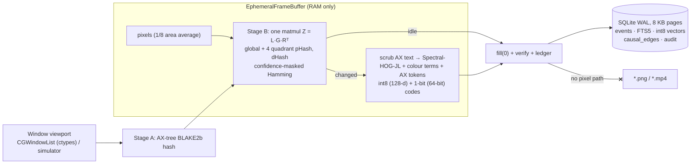
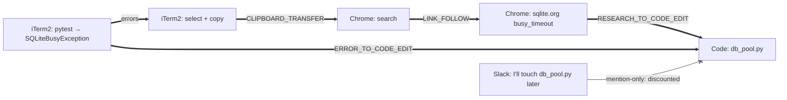

# screengraph-os

**Your desktop's memory as a causal graph, not a video. Zero screenshots on disk.**

screengraph-os watches your windows the way a debugger watches memory. It splits the desktop into per-window viewports and drops idle frames in about 0.09 ms with a 2D-DCT perceptual gate. Each frame is reduced to int8 + 1-bit patch embeddings and scrubbed accessibility text, then the pixel buffer is `memset(0)` before anything touches disk. Every semantic change becomes a node in a **Hawkes-process cross-app causal graph**. That lets you ask:

> *"Why did I change `db_pool.py`?"*
> → `pytest` raised `SQLiteBusyException` in the terminal → you copied it → searched it → opened the SQLite `busy_timeout` docs → edited `db_pool.py`.

screengraph-os ships as a library, a Typer CLI, a Rich TUI and an **MCP server** for any MCP client (Cursor, Gemini CLI, …). It is built on `numpy` + `scipy` + SQLite (WAL, FTS5, binary vector blobs) only: no LangChain/LlamaIndex, no vector DB server, no GPU. Live capture on macOS uses CoreGraphics through `ctypes`, with no pyobjc and no compiled extensions.

```
$ screengraph why db_pool.py
why db_pool.py?  (0.6 ms)
  root cause #11 [iTerm2] pytest — ~/src/acme-api
     File "src/app/db_pool.py", line 88, in acquire
  chain
    [iTerm2] pytest — ~/src/acme-api <- SEMANTIC_CONTINUATION (errors:sqlitebusyexception)
    [Google Chrome] SQLiteBusyException: database is locked - Google Search <- CLIPBOARD_TRANSFER
    [Google Chrome] Pragma statements supported by SQLite <- LINK_FOLLOW (link:sqlite.org/pragma.html)
    [Code] ● db_pool.py — acme-api — Visual Studio Code <- ERROR_TO_CODE_EDIT (doc_path:db_pool.py)
```

> **Read this before the numbers.**
> - **Accuracy numbers come from a deterministic synthetic workspace simulator** that ships with the repo and was developed alongside the engine. They show the pipeline is correct end to end; they are not evidence of accuracy on real desktops.
> - **The default visual encoder is generic but training-free.** It uses spectral DCT, HOG and colour descriptors fused by a random projection. It is not grounded in words: text queries match **colour terms** and **on-screen text**, not concepts like "spike" or "tree diagram". An *optional* layer of hand-written UI-object detectors exists as a clearly labelled ablation; it was tuned together with the simulator.
> - **The live macOS capture was verified on one Mac** (Screen Recording granted, Accessibility not granted). Real-desktop retrieval *quality* has not been measured: there is no labelled real-world dataset yet.
> - **The "legacy" storage figure is a parametric model**, not a measurement of any product.

---

## Results

Measured by `python -m evals.benchmark_suite --live 5` on an Apple-silicon Mac (macOS 27.2, arm64, 14 cores, Python 3.11.18, NumPy 2.4.6, SQLite 3.53.1). Raw output is in [`evals/latest_report.json`](evals/latest_report.json). The full run takes about 40 s, including a 10,000-event scale run, a 10-seed sweep, the UI-concepts ablation and a 5-tick live capture. **Latencies were measured while other applications kept the machine's load average around 20 (14 cores).** In a quieter run made just before the final change, which only adds buffer wipes inside the encoder and leaves the gate untouched, they were about 15–30 % lower (gate p99 0.159 ms). Accuracy and storage numbers are deterministic and unaffected.

**Synthetic workload:** a scripted 60-minute session on a 5120×1440 ultra-wide plus a 2560×1440 monitor. Five windows (iTerm2, Chrome, VS Code, Grafana, Slack) produce 450 window ticks: 377 idle or cursor/caret-only and 73 semantic changes. The session contains 4 multi-hop debugging chains, 6 visual artifacts, 15 injected secrets, and hard negatives such as a chat message naming the file about to be edited.

### 1. Idle gate & storage (int8 + 1-bit)

| Metric | screengraph-os | Note |
|---|---|---|
| Frames dropped by the pHash + AX gate | **82.9 %** (373 / 450) | 98.9 % of idle ticks; 4 cursor-noise false passes |
| Semantic changes missed | **0** / 73 | includes a canvas-only chart spike (caught by the quadrant hashes) |
| Gate latency, dropped frames (p50 / p95 / p99) | **0.090 / 0.136 / 0.194 ms** | budget < 0.20 ms ✅; the p99 *stretch* target of 0.15 ms is **not** met (0.159 ms in a quiet run) |
| Storage growth per stored event | 4.1 KB | int8 patches 2,048 B + int8 global 256 B + 1-bit codes 160 B + text/FTS/edges |
| **Projected 30 days × 8 h** | **76.8 MB** (10 seeds: 76.8–86.7 MB, mean 81.7) | target < 95 MB ✅ |
| Same, Phase 1 formula | 112.1 MB | see the note below |
| Image files / pixel-sized blobs on disk | **0 / 0** (max blob 2,048 B) | |
| RAM buffers non-zero after ingest | **0** / 450 frames; 758 buffers (102 MB) zeroed, 0 verification failures | |

*Projection method.* Phase 1 multiplied the **whole** database file, including its fixed empty-schema pages (147 KB), by 240 hours. The current formula counts the schema once and projects only the per-hour growth. The old-formula figure is reported alongside, so you can see how much of the improvement comes from the method change and how much from the engineering:
- int8 scalar quantization: about 1.4 KB/event saved
- 8 KB SQLite pages: a 2.6 KB vector row wasted 37 % of a 4 KB page
- sparse concept JSON

### 2. Causal root-cause tracing ("why did I edit this file?")

| Method | Root-cause Recall@1 | Chain precision / recall / F1 |
|---|---|---|
| **screengraph-os** (default generic encoder) | **75 %** (3/4) | **1.000** / 0.958 / 0.977 |
| screengraph-os + optional UI-concept ablation | 100 % (4/4) | 1.000 / 1.000 / 1.000 |
| Flat timestamp ("what happened right before?") | 0 % | F1 0.683 |
| Flat hybrid retrieval (BM25 + dense, no graph) | 75 % | F1 0.475 |

Chain precision is **1.000 on all 10 sweep seeds**. Chat messages that merely mention a file, without error text, a clipboard transfer or a followed link, no longer enter the chain. That is the *mention-only discount*.

The miss is chain C4, whose real root is a **canvas-only Grafana memory spike**: no text changes, only pixels. With nothing grounding "spike" visually, the trace lands one hop downstream, on the first textual failure (`kubectl … OOMKilled`). The simulator-tuned spike detector in the ablation recovers it. A learned vision adapter is the principled fix.

### 3. Visual Patch-MaxSim (default generic encoder)

| Query | Patch-MaxSim R@1 | Patch (row, col) | Quadrant OK | Global-average R@1 |
|---|---|---|---|---|
| red memory spike chart in top-right quadrant | ✅ | (1, 2) | ❌ | ✅ |
| blue architecture tree diagram | ✅ | (1, 2) | ✅ | ✅ |
| orange warning modal | ✅ | (1, 2) | ✅ | ✅ |
| green bar chart of build durations | ✅ | (2, 0) | ✅ | ❌ |
| red failing badge | ❌ (red terminal error text wins) | – | ❌ | ❌ |
| cyan latency line chart | ✅ | (2, 2) | ✅ | ❌ |
| **Seed 7** | **83 %** | | **67 %** | **50 %** |
| 10 other seeds (min / mean) | 67 % / 67 % | | 67 % / 67 % | 50 % / 52 % |
| *Optional UI-concept ablation* | *100 %* | | *100 %* | *83 %* |

These hits come from **colour terms + positioned on-screen text** (panel titles, headings, dialog text), not from understanding shapes. Late interaction still beats a single pooled vector by a wide margin, but this is the honest ceiling of a training-free encoder.

- **int8 vs float32:** same encoder and same queries, with identical Recall@1 (83 %) and localization (67 %). Top event and patch are byte-identical on 5 of 6 queries. On the 6th ("red failing badge"), both precisions return a *wrong* answer and merely break a tie between two near-identical terminal states differently.
- **Matryoshka 64-d prefix:** R@1 drops to 50 %. The generic descriptor needs the 128-d prefix.
- **Query-by-example (`screengraph visual --like EVENT`):** this is where the generic descriptor is actually used. It ranks windows that look and read alike; tested on the dashboard events.

### 4. Privacy & secret redaction

| Metric | Result |
|---|---|
| Injected secrets absent from DB bytes, text columns and the FTS5 vocabulary | **15 / 15** (all 10 sweep seeds: 15 / 15) |
| Scrubber fuzz test (200 random secret sets, in context) | 0 leaks |
| Cross-app linkability | the OpenAI key copied terminal → Slack keeps one `<REDACTED_SECRET:…>` tag, joined by a `CLIPBOARD_TRANSFER` edge |

### 5. Latency (p50 / p95 / p99, ms)

| Stage | p50 | p95 | p99 |
|---|---|---|---|
| (a) pHash gate check (dropped frames) | 0.090 | 0.136 | 0.194 |
| (b) Spectral-HOG-JL encode + int8/1-bit quantization + RAM wipe | 1.635 | 2.171 | 3.019 |
| PII scrub | 0.171 | 0.422 | 0.498 |
| (c) causal edge inference | 0.128 | 0.282 | 0.339 |
| SQLite transaction | 0.113 | 0.245 | 0.463 |
| **Total ingest per stored frame** (budget < 10) | **2.482** | **3.451** | **5.584** |
| (d) 4-way hybrid RRF + graph retrieval, 77 events (budget < 8) | 1.114 | 1.375 | 1.532 |
| (d) same, **10,000 events** | **3.155** | **4.320** | 4.634 |
| `why` causal trace, 10,000 events | 2.714 | 4.218 | – |

At 10,000 events, about 16 eight-hour days at the simulated rate, the DB is 40.9 MB. Ingest is 2.34 / 3.57 / 5.97 ms (p50/p95/p99), with one 20.8 ms outlier above the 10 ms budget. In an earlier run during a load spike (load average 172) the p99 reached 37 ms, which is why the load is now recorded in the report.

### 6. Live macOS capture (`screengraph capture-live --ticks 5 --interval 1.0`)

This ran on this machine as part of the benchmark (`--live 5`). The report stores aggregates only; no titles, app names or text.

| | Result |
|---|---|
| Permissions | Screen Recording ✅ · Accessibility ❌ (not granted, and not prompted) |
| Windows per tick | 7 × 5 ticks → 35 frames, **35 with real pixels**, 0 with AX text |
| Gate | 27 dropped, 8 stored |
| **Engine ingest** (p50 / p95 / max) | **0.093 / 2.384 / 3.265 ms**, all under 10 ms ✅ |
| Encode + quantize + wipe on real pixels | 1.66 / 2.25 ms (p50 / p95) |
| OS side (not part of ingest) | `CGWindowListCreateImage` 28.6 ms p50 per window; ~202 ms per 7-window tick |
| Zero-pixel audit | 0 image files, 0 pixel-sized blobs, 0 frames non-zero after ingest → **PASS** |

The live run found and fixed two real bugs the simulator never exercised. Windows smaller than the encoder's internal grid crashed the HOG stage, and windows smaller than 64 grid pixels would have crashed the gate's resampler. Both now resample exactly, with regression tests.

---

## Quickstart

```bash
git clone <this repo> && cd screengraph-os
python3.11 -m venv .venv && . .venv/bin/activate
pip install -e ".[dev]"

screengraph simulate                         # replay the deterministic 60-min, 2-monitor session
screengraph why db_pool.py                   # root cause + chain + Mermaid graph
screengraph visual "orange warning modal"    # colour + on-screen-text visual search with patch localization
screengraph visual --like 12                 # query-by-example: windows that look like event 12
screengraph search "jwt expired"
screengraph timeline --minutes 15 --causal-only
screengraph active-workspace                 # zero-screenshot semantic state of every window
screengraph privacy-audit                    # zero-pixel proof + redaction counters
screengraph status                           # Rich TUI (live: screengraph dash --simulate)
screengraph eval [--live 5]                  # benchmark -> evals/latest_report.json
pytest                                       # 92 tests (1 opt-in live test: SCREENGRAPH_LIVE_TEST=1)
```

**Real desktop (macOS).** This needs Screen Recording permission for your terminal. Accessibility is optional: it adds AX text, and you can trigger the prompt with `--request-ax`.

```bash
screengraph capture-live --ticks 5 --interval 1.0             # self-test into a temporary DB (deleted afterwards)
screengraph --home ~/.screengraph capture-live --ticks 600 --keep   # keep a real memory
screengraph capture --git-repo ~/src/myproject                # long-running: windows + git working tree
```

`--allow-clipboard` opts into `pbpaste`; the clipboard is never read otherwise. Linux (X11 `wmctrl`/`xdotool`) and Windows (`EnumWindows`) provide window metadata only and are untested here.

**Optional learned vision:** `pip install -e ".[clip]"` and set `Config(vision_adapter="open_clip:ViT-B-32/laion2b_s34b_b79k")`. The adapter's image and text embeddings are mapped into the same space with a fixed orthogonal map, so storage, BQ and MaxSim are unchanged. **This path is not exercised here**: torch/open_clip are not installed and the weights would need downloading. Only the adapter plumbing is unit-tested, with a fake adapter. Because patches are cut from the 1/8-scale capture, a learned adapter would want higher-resolution crops.

---

## MCP server

```json
{ "mcpServers": { "screengraph": {
    "command": "/abs/path/to/.venv/bin/screengraph", "args": ["mcp"],
    "env": { "SCREENGRAPH_HOME": "/Users/you/.screengraph" } } } }
```

The JSON block goes in your MCP client's server config, e.g. `~/.cursor/mcp.json` (Cursor) or `~/.gemini/settings.json` (Gemini CLI). The server speaks JSON-RPC 2.0 over stdio (protocol `2025-06-18`, `2025-03-26`, `2024-11-05`) and exposes these tools:
- `screengraph_active_workspace`
- `screengraph_causal_why`
- `screengraph_visual_search`
- `screengraph_timeline_replay`
- `screengraph_ingest_event`
- `screengraph_privacy_audit`
- `screengraph_search` (4-way hybrid)

It calls `refresh()` before each query, so a separate `capture` process can keep writing; SQLite WAL allows one writer and many readers.

---

## Architecture





Source layout:
- `capture/`: `ephemeral.py` (wipe + SHA-256 ledger), `phash.py` (fused gate), `live.py` (ctypes macOS), `os_hooks.py` (Linux/Windows/clipboard/git), `simulator.py`.
- `embeddings/`: `patch_encoder.py` (Spectral-HOG-JL, int8/1-bit, adapters), `maxsim.py` (funnel + MaxSim + IDF), `ui_concepts.py` (*optional* ablation).
- `graph/`: `causal_engine.py`, `retriever.py`.
- `db/`, `privacy/`, `interfaces/` (MCP, TUI, CLI), and `engine.py`, which orchestrates the pipeline.

---

## The math

**Gate.** Area-average the frame to a 64×64 luma grid $G_2 = A_r X (A_c^\top\otimes w)$. A **single** product $Z = L\,G_2\,R^\top$ then yields every hash input. $L$ and $R$ stack three things:
- $C_8 M$: the 8×8 low DCT of the 2×-averaged frame
- $\mathrm{blockdiag}(C_8, C_8)$: the four quadrant DCTs
- the dHash 8×9 averaging rows

pHash bits are $D_k > \mathrm{median}(D_{1..63})$. Only confident bits count: $|D_k - \mathrm{med}| \ge 0.25\,\overline{|D-\mathrm{med}|}$, and $d(a,b) = \mathrm{popcount}((h_a\oplus h_b)\wedge m_a\wedge m_b)$. A frame is dropped iff the AX hash is unchanged, $d_{\text{global}}\le4$, $d_{\text{dHash}}\le6$ and $\max_q d_q\le2$.

**Spectral-HOG-JL descriptor** (per patch $p$ of a 4×4 grid, any RGB/RGBA input):
- **Spectral:** opponent channels $Y=0.299R+0.587G+0.114B$, $O_1=R-G$, $O_2=B-\tfrac{R+G}{2}$, area-averaged to 16×16. Orthonormal DCT-II $C\,B\,C^\top$, keeping zig-zag $u+v<6$ for $Y$ (21 coefficients) and $u+v<3$ per chroma channel (6 + 6), with signed-sqrt compression.
- **Gradients:** Scharr at 32×32, an 8-bin unsigned orientation histogram (magnitude-weighted, Hellinger-normalized), edge density and mean magnitude.
- **Colour:** basic colour-term fractions (11).

Each group is L2-normalized and concatenated into $f_p\in\mathbb{R}^{54}$. It is projected by a seeded Achlioptas matrix $R_{ij}\in\{\pm1/\sqrt d\}$, which satisfies the Johnson-Lindenstrauss lemma, and then made **orthogonal to the colour-word subspace**: $\tilde R = R - R\,Q_cQ_c^\top$, with $Q_c$ = QR of the colour-concept basis. Texture energy therefore never registers as a colour match. A unit test checks $|\,\tilde R^\top f\cdot B[\text{colour}]\,|<10^{-4}$.

**Patch vector.**

$$w_p = \mathrm{norm}\Big(0.6\,\widehat{\tilde R^\top f_p} + \widehat{\textstyle\sum_c v_{pc}B[c]} + 0.8\,\widehat{\textstyle\sum_t \log_2(1+\sum_{n\ni t}\omega_n)\,B[t]}\Big)$$

$B[\cdot]$ are seeded Gaussian concept vectors. $v_{pc}$ is the salient-colour share, and the $t$ are scrubbed AX tokens placed in the patch where they are rendered.

**int8 + 1-bit.** Per window, $s = \max|w_{p,i}|/127$ and $q=\mathrm{round}(w/s)$ on the 128-d Matryoshka prefix. Stage 1 is 64-bit sign codes with a Hamming distance → cos LUT funnel. Stage 2 is **asymmetric** rescoring, $s_n\,(q_{\text{float32}}\cdot q^{(n)}_{\text{int8}})$.

**MaxSim with query IDF and a spatial prior.**

$$\mathrm{MaxSim}(Q,W)=\sum_i \mathrm{idf}_i\max_p s_p\,(q_i\cdot w_p),\qquad \mathrm{idf}_i = 1+\ln\tfrac{1+n}{1+\mathrm{df}_i}$$

**Causal score + Hawkes responsibility.**

$$S(i\to j)=0.25\,e^{-\lambda\Delta t}+0.20\cos(E_i,E_j)+0.45\,\mathrm{Bridge}+0.10\,P(\mathrm{app}_j\mid\mathrm{app}_i),\qquad p(i\to j)=\frac{S(i\to j)}{\mu+\sum_k S(k\to j)}$$

An edge is kept iff $S\ge0.40$ and it carries evidence. Several rules decide what counts as evidence:
- **Destination novelty:** evidence must be new in $V_j$'s own window.
- **Ambient suppression:** entities in more than 35 % of recent events are ignored.
- **Mention-only discount:** a chat source without an error has its path/symbol bridges multiplied by 0.35.

The root is the earliest error or anomaly in the causal ancestry, ranked by the geometric-mean edge score.

**Retrieval** is RRF over:
- FTS5 BM25 (with df > 20 % term pruning, on a worker thread)
- dense cosine
- Patch-MaxSim
- a causal-graph propagation channel

---

## How it compares

All competitor statements below are **taken from each project's own documentation** (accessed Nov 2026; sources linked). They are the projects' claims, not something we benchmarked. Products change.

| | **screengraph-os** | Microsoft Recall | Screenpipe | ScreenMind | AgenticVision |
|---|---|---|---|---|---|
| What is persisted | AX text + int8/1-bit patch vectors + causal graph; **no images** | Periodic **snapshots** (screenshots) + a vector DB, encrypted | **JPEG screenshots** + audio chunks (`~/.screenpipe/data`) + SQLite text | **Screenshots** on disk (`~/.screenmind`), auto-deleted after N days (default 7) + SQLite | **JPEG thumbnails** + metadata in a binary `.avis` file |
| Capture trigger | per-window AX hash + pHash/quadrant gate | periodic snapshots | event-driven (app switch, focus, clicks, typing pauses, clipboard), ~5 s idle fallback | content-change detection with pHash dedupe, max interval 40 s | on demand (files, base64, screenshots, clipboard) |
| Text source | accessibility tree (+ window titles) | on-device semantic index over snapshots | accessibility tree first, OCR fallback | Gemma 4 vision analysis + EasyOCR | image description / metadata |
| Visual representation | training-free Spectral-HOG-JL patches (optional learned adapter) | on-device AI (NPU) | – | MiniLM text embeddings of the analysis | CLIP ViT-B/32 (512-d) via ONNX |
| Secret / PII handling | format + Luhn + entropy redaction **before indexing**; keyed linkable tags | sensitive-info filtering on by default: snapshots with detected passwords/cards are **not saved** | "PII redaction" listed; mechanism not documented | sensitive-data filter (cards, SSNs, API keys, JWTs, passwords) on by default | EXIF/location metadata scrubbing |
| Encryption at rest | not built in (rely on disk encryption) | yes (TPM / Windows Hello ESS, VBS enclave) | not stated in the architecture doc | optional (Fernet), off by default | not stated |
| Cross-app causal "why" graph | **yes** | not documented | not documented | not documented | not documented |
| Patch-level spatial localization | yes (row, col, screen bbox) | not documented | not documented | layout regions in the analysis | pixel-level diffing |
| MCP server | yes (7 tools) | not documented | yes (`screenpipe-mcp`) | yes (stdio) | yes (21 tools) |
| Platforms | macOS live capture verified; Linux/Windows metadata (untested) | Windows 11 Copilot+ PCs | macOS, Windows, Linux | Windows, macOS, Linux | Rust core; benchmarks on macOS |

"Not documented" means we did not find it in the cited docs, not that it is absent.

The **"44,949 MB/month" legacy figure** in `evals/` models continuous 0.5 fps video capture. It is **not** a model of these products: event-driven tools like Screenpipe and ScreenMind store far less, and we did not measure them.

Sources:
- Microsoft: [Manage Recall](https://learn.microsoft.com/en-us/windows/client-management/manage-recall), [Privacy and control over your Recall experience](https://support.microsoft.com/windows/d404f672-7647-41e5-886c-a3c59680af15), [Recall security architecture](https://blogs.windows.com/windowsexperience/2024/09/27/update-on-recall-security-and-privacy-architecture/)
- Screenpipe: [architecture](https://docs.screenpipe.com/architecture)
- ScreenMind: [ayushh0110/ScreenMind](https://github.com/ayushh0110/ScreenMind)
- AgenticVision: [agentralabs/agentic-vision](https://github.com/agentralabs/agentic-vision)

---

## Benchmark methodology & caveats

- **The simulator was co-developed with the engine.** Phase 1's visual and C4 numbers (100 %) came from object detectors written alongside the simulator's renderers. Those detectors are now an explicit ablation (`Config(ui_concepts=True)`), and the default numbers above are what a generic encoder achieves.
- **Several engine rules were added after the benchmark exposed failures:**
  - shell-prompt stripping
  - destination novelty
  - the per-window parent cap
  - query IDF
  - the mention-only discount

  The 10-seed sweep varies noise, data and secrets, not the script. It shows stability, not generalization.
- **Baselines are our own re-implementations.** Flat timestamp and flat hybrid retrieval (unpruned BM25 + dense, excluding same-window and future events) live in this codebase. The global-average baseline uses the same encoder and query IDF as Patch-MaxSim.
- **Zero-pixel guarantee, precisely:**
  - No storage API accepts pixels.
  - Every frame buffer and every registered pixel-derived intermediate (including the gate's full-resolution float copy and the encoder's resampling buffers) is zeroed and verified on exit, including on exceptions.
  - In live capture, our private `CFData` copy of the bitmap is `memset` to 0 before `CFRelease`.
  - Tests verify that no file on disk is a frame (SHA-256) and that no high-variance pixel window from any semantic frame appears on disk.

  Not covered: the `CGImage` backing store belongs to CoreGraphics, and NumPy may make transient internal copies we cannot wipe.

### Known limitations / roadmap

- **Word-grounded vision needs a learned model.** The open_clip adapter is plumbed in but untested here. Real-desktop retrieval quality needs a labelled dataset.
- **AX text on macOS needs Accessibility permission.** Without it, live capture indexes window titles + pixels only. Linux AT-SPI and Windows UIAutomation text are not implemented.
- **Gate p99 is 0.159–0.194 ms on the session** (quiet vs loaded machine), and 0.256 ms p95 on real frames in the live run. The p99 < 0.15 ms stretch target is not met.
- **Root ranking** uses an "earliest failure signal" heuristic; canvas-only anomalies are invisible to it without a visual anomaly detector.

## License

[MIT](LICENSE)
